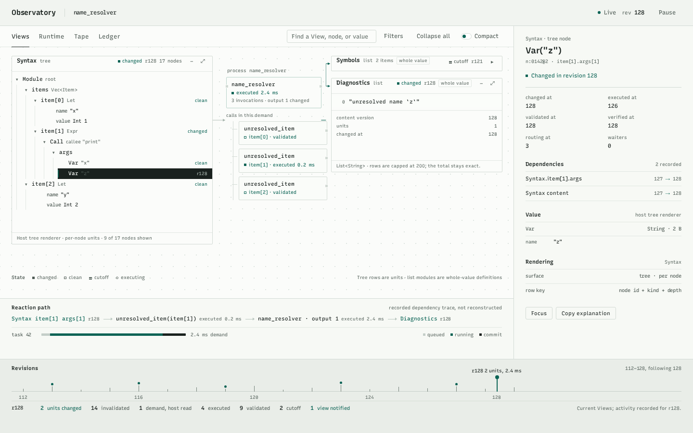

# Runtime visualization: the Observatory

**Status:** Proposed, revised after design review  
**Revision:** 2 — View-native board, modular viewports, collapse/expand  
**Date:** 2026-11-03  
**Feature:** opt-in runtime observation, projection service, and a React page  
**Touches:** `irrigation-runtime`, `irrigation`, a new `irrigation-observe` crate, a new
`web/observatory` app, and one reference host example

> Show, truthfully and at a glance, what changed, what the runtime did in
> response, and what it deliberately did not do.



*Design artifact, not production code. It is the reference for layout, tokens,
module behavior, and copy. `Symbols` is collapsed to its header; every module
header carries collapse/expand controls. See [§3.6](#36-modes-and-module-states)
and [§4.13](#413-frontend-implementation).*

**Revision 2 changes.** The default is no longer one node-link graph. Each View
is drawn natively (tree, list, map, set, graph, scalar), each View is a
collapsible/expandable module, whole-value definitions are marked as such, and
the low-level runtime graph is the secondary Runtime mode.

**Implementation status.** The observation kernel, the projection/renderer
layer, the HTTP+SSE server, the reference host, and the React board are built
and tested. The page also drives the host: a generic text-document editor
(`GET/POST /api/v1/source`) and discovered host actions
(`GET /api/v1/actions`) — see "Editing from the page" in the status file. [`runtime-visualization-status.md`](runtime-visualization-status.md)
records exactly what shipped, the semantic divergences above, and what remains
(the Runtime-mode canvas and the richer per-revision replay).

---

## Contents

[0. Decision in one page](#0-decision-in-one-page) ·
[1. What exists](#1-what-exists-today-and-what-is-missing) ·
[2. Truth model](#2-the-truth-model) ·
[3. Experience design](#3-experience-design) ·
[4. Architecture](#4-architecture) ·
[5. Demo host](#5-reference-scenario-and-demo-host) ·
[6. Verification](#6-verification) ·
[7. Milestones](#7-milestones) ·
[8. Risks](#8-risks-and-mitigations) ·
[9. Decisions](#9-open-decisions) ·
[10. Done](#10-what-done-looks-like) ·
[Appendices](#appendix-a--state-derivation-at-a-glance)

---

## 0. Decision in one page

Build a first-class, **opt-in** observation path:

1. **A compile-time `observe` feature on `irrigation-runtime`.** With it off, no
   observation module, event, or event branch is compiled. The existing runtime
   behavior is unchanged; the only additive metadata is small and measured.
   With it on but no observer attached, every instrumentation point is one
   predictable branch.
2. **A passive recorder.** Runtime workers push compact events into a bounded
   lock-free ring. They never format names, never call back into the runtime,
   and never wait for a UI. A dropped event increments a counter and is reported
   as a drop; it is never silently lost.
3. **A projection layer in a new `irrigation-observe` crate.** It maps internal
   IDs, versions, and trace facts into revision-tagged, read-only JSON:
   native View renders, graph nodes/edges, View facts, node explanations,
   revision records.
4. **A small Axum server.** It drains events on its own thread, keeps a bounded
   revision journal, streams workspace metadata and event batches over
   Server-Sent Events, and serves bounded native View renders on demand. It is
   read-only; it never triggers demand.
5. **A React page built from modular View viewports.** The default surface is a
   board of living Views, not a graph of runtime nodes. Each View is drawn in
   its own idiom: tree as an outline, list as rows, map as key/value pairs, set
   as membership, graph as a compact network, scalar as fields. A module
   collapses to a 32 px header and expands to a focused work surface without
   losing its state or version. The revision tape is the time axis; the
   low-level causal graph moves to a secondary **Runtime** mode for framework
   debugging.
6. **View-native renderers supplied by the host.** A generic runtime cannot
   truthfully draw an AST, a token list, or a symbol table. The host registers
   renderers per View; they run outside the runtime lock against committed
   snapshots. A View without a renderer shows schema/counts and no invented
   rows; a value without a formatter stays opaque. Whole-value definitions never
   get per-row change marks.

The page answers four questions without pretending to know more than it does:

- **What changed?** The data the user recognizes — a tree node, a list row, a
  map key, a graph node — plus the View/unit versions behind it.
- **What reacted?** Invalidation counts, demand tasks and their causes,
  validation/execution/cutoff counts, notifications.
- **Why did the selected output change?** The recorded dependency trace and the
  version that moved, not a guessed explanation.
- **What did not happen?** No demand, no execution, a cutoff, a suspect branch,
  a failed task — all first-class states.

The default board is deliberately **not** a node-link graph. Compiler and
application developers think in ASTs, token streams, symbol tables, maps, and
diagnostics. A graph of runtime nodes forces them to translate their own data
into the runtime's internal shape, and it cannot tell the truth about
whole-value Views: drawing a per-row pulse on a derived list whose definition is
whole-value would invent a granularity the runtime does not have.

The key design constraint is **observation must not change the observed
system**. The server captures snapshots and graph/View facts with read-only
inspection. It never calls `read`, `read_outputs`, `call`, or otherwise forces
demand. When the host demands work, that demand appears in the stream with its
cause; when nobody demands, the page says so.

**v1 deliberately does not include:** exact historical graph scrubbing,
flamegraphs, breakpoints, remote multi-tenant auth, arbitrary value inspection,
or a general metrics backend. Those are follow-ups, not silent gaps.

---

## 1. What exists today, and what is missing

The runtime already exposes useful diagnostics:

| API | What it gives | Limit for a UI |
|---|---|---|
| `Runtime::stats()` | node/execution/validation/revision/invalidation counters, task counts | no timeline, no per-revision attribution, no causes |
| `Runtime::explain()` | graph size, kinds, changed-node count, wait count | aggregate snapshot, not an event stream |
| `Runtime::explain_node()` | versions, state, waiters, scope path, ordered dependency explanations | single node, synchronous; no names/source spans; can panic on reclaimed nodes |
| `Runtime::dump()` | every node, labels, deps, dependents, unit/debug strings | unbounded clone, generic labels, no filter |
| `Runtime::wait_edges()` / `wait_cycles()` | task wait graph | no task history or durations |
| `Runtime::memory_report()` | retained memory accounting | not revisioned |
| `Runtime::identity_report()` | site/invocation reuse counters | aggregates only |

This is enough to prove the runtime works. It is not enough to *see* an
incremental reaction. The missing pieces are:

1. **An event stream.** There is no record that a transaction was staged,
   committed, or rejected; that a trace validation was attempted or rejected;
   that a task suspended and on which node; that an output changed or was cut
   off. `stats()` counts some of these, but counts cannot be attributed to a
   revision, task, or node.
2. **A safe projection.** `dump()` returns internal node records with generic
   labels (`"site"`, `"unit"`, `"invocation output"`). A UI needs stable logical
   names (`Symbols.field 0`, `item[1]`, `resolver::name_resolver · output 1`),
   filters, caps, and a consistent revision tag.
3. **A transport with integrity.** The page needs snapshots plus deltas, with
   explicit resynchronization when a client falls behind.
4. **Honest value display.** `Value` is type-erased; the generated
   `ViewDescriptor::content.debug` currently returns only the View name
   (`crates/irrigation-macros/src/view.rs`, `#debug_fn`). There is no generic
   payload rendering, and inventing one would be a lie. The plan uses host
   renderers for View bodies, optional formatters for scalar/row values, and
   shows type/size otherwise.
5. **A design that distinguishes reactions.** The most important UI work is not
   drawing a graph; it is refusing to conflate *invalidated*, *executed*,
   *changed*, *cut off*, and *notified*.
6. **Native render models.** A runtime View is typed user data; only the host
   knows that a `Syntax` field is an AST, a `Tokens` field is a token stream, or
   a `Symbols` field is a whole-value list. The server needs structured render
   models, not just node labels, or the page will draw every View as the same
   generic graph.

### 1.1 Why the default cannot be one node-link graph

The first design iteration did exactly that: every View was projected into one
causal field of runtime nodes. It was truthful, but it was the wrong default for
the people building compilers and applications with this runtime.

- **It makes the user translate.** A compiler developer looking for the changed
  `Var("z")` has to find it among site nodes, unit nodes, invocation bodies, and
  output projections. Their mental model is the AST, not the node arena.
- **It erases the View's shape.** A tree is a containment outline; a list is an
  ordered strip; a map is a key/value table; a set is membership; a graph is a
  network. Drawing all of them as identical rounded nodes removes the very
  structure the developer is debugging.
- **It invites false granularity.** Derived lists and sets may be whole-value
  definitions; a per-row changed pulse would claim an identity the runtime does
  not have. The correct drawing is a whole-module change mark plus honest copy.
- **It does not scale to an app.** Ten Views × hundreds of units is a hairball.
  Ten compact modules with collapse, focus, and a shared tape is a workbench.

The low-level graph is still valuable, but for a different question: *why did
the runtime schedule this, validate that, or suspend there?* That is a framework
author's question, so it becomes the secondary **Runtime** mode. The primary
**Views** mode uses native drawings and modular panels.

The existing plan's §11.6 already asks for an inspector that answers "why did
this output change?", "what was validated versus actually executed?", "where did
identity reuse fail?", and "what blocks progress?" ([the concurrent plan,
§11.6](concurrent-incremental-system-plan.md)). This feature is the concrete
delivery vehicle for that requirement.

---

## 2. The truth model

The page is only as good as its semantics. This section is normative: if the UI
and this table disagree, the UI is wrong.

### 2.1 Terms with exact meanings

| Word in the UI | Exact runtime meaning | Source of truth |
|---|---|---|
| **revision** | A published input revision. A transaction whose final values are equal publishes none. | `State::revision`, `Runtime::revision()` |
| **changed** | The node's value changed at revision `r`: `changed_at == r`. | `NodeRecord::changed_at`, `NodeCommitted` event |
| **invalidated** | The node was newly marked suspect at `r` by the reverse-dependency walk (`suspect_at == r`). It may never be demanded. | `State::invalidate` return count, `Invalidated` event |
| **suspect** | `suspect_at > verified_at`: the node is not certified at the current revision. | node fields |
| **demanded** | A demand task started for a root/output/component. The cause is recorded. | `DemandStarted` event |
| **validated** | The runtime checked the node's ordered trace and certified it without running the closure. The current `validations` counter counts **successful** validations only. | `validate_trace`, `NodeValidated` |
| **executed** | The node's closure ran and its commit succeeded. A failed attempt is a separate **failed** state, not "executed". | `NodeCommitted`, `executions` counter |
| **cutoff** | The closure executed but its result was equal by the field's `PartialEq`; `changed_at` did not move and consumers were not notified. | `NodeCommitted { changed: false }` |
| **notified** | A subscription callback fired because the watched content/unit version moved. | `SubscriptionNotified` |
| **reused** | A clean fast-path return without validation or execution. It is only observed at `Full` level; otherwise the UI says "not recorded", not "reused". | `NodeReused` |
| **running** | A task owns the node's claim and is executing. | `NodeState::Running`, `NodeClaimed` |
| **waiting** | A task is suspended on another task's node. | wait graph, `TaskWaiting` |

Four consequences drive the whole design:

1. **Invalidated is not changed and is not recomputed.** An edit can invalidate
   a thousand nodes and demand zero of them. The UI must be able to show that
   state without implying failure.
2. **Executed is not changed.** A cutoff is a successful execution with an equal
   result. It is the most important optimization to show, and the easiest to
   mislabel as "no work".
3. **No demand is a valid outcome.** The runtime is lazy between edits; a
   revision can be published and nothing happens until a host reads. The page
   says "no demand recorded", never "reaction complete" without evidence.
4. **Notification is a separate edge.** A changed View does not imply a
   subscription fired; the subscription's previous/current versions decide.

### 2.2 Granularity and render truth

The renderer's drawing must match the runtime's actual unit structure. The
projection carries a `granularity` for every field:

| Granularity | When the runtime has it | What the UI may claim |
|---|---|---|
| **per entity** | source list/map/set/graph/tree units; keyed derived list/set definitions; map keys; scalar fields | a row/key/node has its own `changed_at`, membership, and unit version; per-row change marks are allowed |
| **whole value** | a derived list/set defined as one value; a `Reduced` aggregate; a View content projection without per-entity units | only the module/content changed; rows are display rows with no unit identity; no per-row change pulses |
| **no renderer** | no host renderer registered | schema, counts, type, and versions only; no invented rows; granularity is still reported |

Granularity is derived from the runtime, never guessed from "source vs derived":
the projection consults the region's keyed fields and unit table, plus the field
kind. A derived list can be keyed (per entity); a source list is per entity; a
derived list can also be whole-value. The same list renderer must therefore
accept both modes and visibly change its claim.

Rules:

- A whole-value list or set may still be **drawn** as rows (that is how a person
  reads it), but the rows are not units. The module header carries the change;
  the footer says `whole value`; no row shows a per-unit change mark.
- A per-entity list/tree/map marks the actual unit rows and shows the unit
  version. The renderer must not group two different units into one row and
  then mark only one.
- A renderer may cap rows (`200` default) and must report `truncated` plus the
  exact total. The cap is display-only; counts stay exact.
- A renderer's output is **host data**, not a runtime fact. The UI labels the
  source (`host tree renderer`, `host list renderer`) and never derives runtime
  state from row order or styling.
- If a field has no renderer, show the schema and counts, not a generic
  node-link graph. The absence is explicit.

### 2.3 Observation is passive

The observer and the projection server are **read-only with respect to
computation**. They may:

- read committed metadata under the runtime's metadata lock;
- capture an immutable `Snapshot` of committed View contents;
- run host renderers/formatters against that snapshot, outside the runtime lock;
- read counters and the wait graph;
- emit events that describe what the runtime already did.

They may **not**:

- call `Runtime::read`, `read_outputs`, `read_projection`, `call`, or any API
  that creates a demand task;
- hold the metadata lock while running user formatters or formatting JSON;
- mutate node state, trigger collection, or attach a subscription that forces
  the root.

This matters because a naive inspector that calls `read()` on every revision
would manufacture the very demand it is supposed to observe. A debugger must not
become a participant.

For this reason the runtime gains a small read-only surface:

```rust
// Under the `observe` feature.
impl Runtime {
    /// Captures committed View content without creating a demand task.
    pub fn inspect_snapshot(&self) -> Snapshot;

    /// Projects committed node/edge facts under one lock, with a cap.
    pub fn probe(&self, query: &GraphQuery) -> GraphFacts;

    /// Like `explain_node`, but returns `None` for a reclaimed/unknown node.
    pub fn try_explain_node(&self, node: NodeId) -> Option<Explanation>;
}
```

`inspect_snapshot` is the diagnostic equivalent of `snapshot()` minus the task
allocation. It is the only snapshot the server uses. `probe` never returns
values, only metadata, type names, and sizes.

When the page offers a "Demand now" control in the demo host, that control is
explicitly labelled as a runtime action. It creates a normal demand task with
cause `HostRead`, and the resulting work appears in the stream. The inspection
server itself never has such a button.

### 2.4 Value truth

Values are the easiest place to fabricate. The rules:

- **No generic payload rendering.** `Value` is `Arc<dyn Any>`; there is no
  portable `Debug`. The generated View `debug` function returns the View name
  today, so it is not a payload formatter.
- **The generic inspector always shows:** View schema, unit key, presence,
  version, routing version, and payload size (`size_of_val` on the erased
  value). A concrete type name is *not* available from a type-erased `Value`, so
  the page does not claim one; a host formatter supplies it when it registers.
- **Payloads are shown only by a host-registered renderer or formatter.** The
  renderer draws the module body; the formatter draws one selected scalar/row.
  Both run on a render worker against a committed `Snapshot`, never under
  the runtime lock, and their output carries the source label
  (`host renderer` / `host formatter`).
- A formatter panic is caught and rendered as `formatter failed: <message>`; it
  never takes down the server or the runtime.
- A value that has no formatter is shown as `opaque <Type> · <N> B`, not as an
  empty string or a fabricated graph.

Example registration in the reference host:

```rust
use irrigation_observe::{Observatory, ValuePreview};

Observatory::new(runtime)
    .formatter::<Diagnostics>(|snapshot| {
        let items = snapshot.view::<Diagnostics>().field0();
        ValuePreview::list(items, "List<String>")
    })
```

The formatter receives a plain `&Snapshot`; it can use the normal typed View
accessors. It cannot see internal node records.

### 2.5 History truth

The runtime keeps no historical states: node fields hold the *current* version
facts. The server therefore keeps a **bounded revision journal** of what it
observed, not a time machine.

v1 guarantees:

- Every published revision in the journal has an exact record of its
  transaction label, changed-unit count, invalidation count, demand tasks,
  execution/validation/cutoff counts, notification count, and measured spans.
- The Views board renders current module content; the Runtime graph shows the
  current structure. Selecting an older revision applies the recorded activity
  to the current modules/structure, and the page states: *"Structure is
  current; activity is recorded for r<N>."* A whole-value list does not acquire
  row-level history it never had.
- If a revision has fallen out of the journal, the tape shows the retained
  boundary and disables selection beyond it. It never reconstructs a graph from
  guesses.
- Exact per-revision graph snapshots are a later, explicit mode with its own
  memory budget. They are not silently simulated.

This is less ambitious than a time-travel debugger, and it is honest. A small
graph can gain exact capture later without changing the UI contract.

### 2.6 Loss and sampling truth

- Counters (`executions`, `invalidations`, `revisions`, etc.) are exact.
- Per-node event lists are bounded. If the ring drops events, the server reports
  `dropped_events` and the UI marks the activity as `incomplete`.
- The Runtime graph itself is rebuilt from a fresh probe, so its state is
  authoritative even when the event list is incomplete.
- The page never smooths over a gap. A gap produces a visible `resyncing` state,
  not a slightly stale but confident graph.

---

## 3. Experience design

### 3.1 Brief

| Axis | Decision |
|---|---|
| Audience | The compiler/application developer is primary. They live in ASTs, token streams, symbol tables, maps, and diagnostics. The framework author is secondary, served by the Runtime mode when they need validation/scheduling detail. |
| Primary job | Recognize their own data structures in the page and see what changed in them and around them, without translating into runtime node IDs. |
| Secondary job | See the runtime reaction — invalidated, executed, validated, cutoff, notified — as a quiet overlay on that data. |
| Tone | A measuring instrument for data that happens to be live: precise, quiet, legible. Not a SaaS dashboard, not a marketing page. |
| Constraints | Modular Views; compact rows; collapse and expand; keyboard accessible; truthful under load; works at 1440×900 and on a narrow laptop. |
| Anti-goal | One node-link graph for every View. A wall of charts. A per-row change pulse on a whole-value definition. |

The brief is grounded in the subject: a compiler or application is a set of
user-recognizable Views (tokens, CST, AST, symbols, diagnostics, maps) whose
producers and consumers react incrementally. The page should show those Views as
themselves, with the runtime's reaction as a measured layer over them, not
replace them with a homogeneous graph of internals.

### 3.2 Concept: a board of living Views and a revision tape

Three surfaces carry the product:

1. **The View board** is space: modular panels for the user's Views, each drawn
   in its native idiom — tree outline, list rows, map pairs, set membership,
   graph network, scalar fields. A panel is the unit of collapse/expand/focus.
2. **The revision tape** is time: one tick per published revision, with the
   selected revision's exact reaction counts underneath. It is the signature
   element and the only place where the page is allowed to be tactile.
3. **The reaction path** is causality: a single recorded path from the changed
   row/node to the selected output, plus the task that did the work. It answers
   "why this one?" without asking the user to trace a node graph.

The low-level causal graph is not gone; it is the **Runtime** mode. It is the
right surface for "which node validated, which task suspended, where is the
primitive site?", but it is the wrong default for "my AST changed".

The design spends its boldness on the tape and the native drawings. Everything
else — header, module chrome, inspector — stays quiet.

### 3.3 Design tokens

The palette is a cool mineral paper, graphite ink, and one deep viridian signal.
It is not warm cream, not near-black with acid green, and not a card kit.

| Token | Hex | Use |
|---|---|---|
| `--paper` | `#F1F4F0` | page and header |
| `--field` | `#FBFCFA` | board and module bodies |
| `--panel` | `#F7F9F5` | inspector, story, rail |
| `--tape` | `#E9EDE8` | revision tape |
| `--ink` | `#19211E` | primary text, selected row fill |
| `--muted` | `#4F5B55` | secondary text |
| `--faint` | `#5F6B65` | metadata text (still ≥ 4.5:1) |
| `--line` | `#D2DAD4` | module borders, rules, flow lines |
| `--signal` | `#0B6355` | changed/committed, live state, active path |
| `--amber` | `#8A6206` | running/executing, latency |
| `--suspect` | `#8A5B2E` | invalidated/suspect |
| `--error` | `#A23B32` | failure |

Contrast: ink on field is 15.9:1; muted is 6.9:1; faint is 5.4:1
(4.7:1 on the tape); signal is 7.0:1; amber is 5.3:1; suspect is 5.6:1. The
palette is checked with a contrast tool during implementation, not eyeballed.
Color is never the only encoding: each state also has a glyph and a word.

### 3.4 Typography

One variable family: **Recursive** (Google Fonts, OFL), using its `MONO` axis for
structured View rows (tree nodes, list values, map keys, versions) and its sans
axis for prose. This is a deliberate single-family choice: the page is an
instrument, and a second display face would make it editorial rather than
operational.

| Role | Size / axis | Notes |
|---|---|---|
| Wordmark | 15 px, wght 640, CASL 0.35 | the only expressive type moment |
| Module title | 12 px, wght 620 | sentence case; never all caps |
| View rows | 10.5–11.5 px, MONO | tree depth, list indices, map keys, values |
| Body / inspector | 13 px / 1.4 | line length < 80 characters in the rail |
| Metadata | 9.5–10.5 px, MONO for versions and counts | tabular numerals |
| Headings | 11.5–18 px, wght 590–600 | sentence case |
| Tape axis | 9.5–10.5 px, MONO | numbers only |

No all-caps eyebrow labels. No letterspaced small caps. No monospace for prose;
mono is reserved for identifiers, versions, and structured View data.

### 3.5 Layout

The page is a single full-bleed workbench:

```
┌──────────────────────────────────────────────────────────────────────────────────┐
│ Observatory  name_resolver            ● Live  rev 128                  Pause      │ 54
├──────────────────────────────────────────────────────────────────────────────────┤
│ Views  Runtime  Tape  Ledger      Find…   Filters  Collapse all  Compact          │ 44
├──────────────────────────────────────────────────────────────────┬───────────────┤
│ Syntax  tree                      changed r128        –  ⤢       │ Var("z")      │
│ ▾ Module root                                                    │ Syntax tree   │
│   ▾ items                                                        │ changed r128  │
│     ▾ item[0] Let              clean                             │ facts         │
│     ▾ item[1] Expr             changed   ┌ name_resolver ┐       │ dependencies  │
│       ▾ Call print                       │ executed 2.4ms│       │ value         │
│         ▾ args                           └───────────────┘       │               │
│           Var "x"              clean     ▸ Symbols  whole  cutoff │               │
│           Var "z"              r128      ▾ Diagnostics  changed  │               │
│     ▾ item[2] Let              clean     "unresolved name `z`"   │               │
├──────────────────────────────────────────────────────────────────┤               │
│ Reaction path: item[1] args[1] → unresolved_item → output 1      │               │
│ task 42  ▓▓▓▓▓▓░░  2.4 ms                                        │               │
├──────────────────────────────────────────────────────────────────┴───────────────┤
│ Revisions  112 ───── 116 ───── 120 ───── 124 ───── 128                           │
│ r128  2 units changed  14 invalidated  1 demand  4 executed  2 cutoff …          │ 154
└──────────────────────────────────────────────────────────────────────────────────┘
```

- Header: 54 px, one line, status only.
- Toolbar: 44 px, mode switch left; search, filters, `Collapse all`, density right.
- Board: modular 12-column grid at ≥1280 px; module spans follow field kind
  (tree/graph 6 columns and two rows, list/map 4 columns, set/scalar 3 columns).
  At narrower widths the grid becomes two columns, then one; no horizontal page
  scroll.
- Module: header 32 px, body scrolls internally, footer 20–24 px. Standard
  height is bounded; `Expand` fills the board.
- Inspector: 360–380 px, scrolls independently; becomes a bottom sheet below
  1000 px; collapsible to a 32 px rail.
- Reaction path: 120–140 px at the bottom of the board; collapsible to one line.
- Tape: 140–160 px, full width, always visible; on narrow screens it scrolls
  horizontally but the selected revision stays pinned.

The page has exactly one elevation: a selected tree row or list row is filled
ink. There are no drop shadows, no gradient washes, and no rounded content
cards. Modules are functional plates with a 1 px border, not decorative cards;
their interiors are native data, not marketing content.

### 3.6 Modes and module states

Four modes share the same store, selection, and tape:

1. **Views** (default). The modular View board; native renderers; collapse,
   expand, focus.
2. **Runtime**. The low-level causal graph for framework authors: units,
   invocations, outputs, primitive sites, task waits, validation/execution
   edges. The old causal-field design lives here, secondary.
3. **Tape**. A full-width revision history with per-revision rows; useful for
   comparing reaction costs and finding a no-op or a spike.
4. **Ledger**. A sortable table of Views, fields, units, versions, producers,
   granularity, and changed-at revisions. This is the accessible, dense answer
   to "what data does the runtime think it has?".

The mode switch is a text tab row, not a segmented control with pills. The
selected mode has a single 1 px ink underline.

Each View module has three states:

- **Collapsed.** A 32 px header only: name, kind, count, state glyph, version,
  granularity badge (`whole value` when applicable), and an expand button. It
  still shows changed/cutoff; collapsing hides data, never a reaction.
- **Standard.** The native renderer at its default height; body scrolls; footer
  carries granularity/cap facts.
- **Expanded (extended).** The module fills the board. The other modules
  become a compact module rail (headers only) so the user can switch focus
  without losing the board. `Esc` or `Back to board` returns.

Only one module is expanded at a time. Expansion is a view operation; it never
demands a View or changes the runtime.

```
COLLAPSED                          EXPANDED (Syntax focused)
┌───────────────────────────┐      ┌─────────────┬───────────────────────────┐
│ ▸ Symbols  list  r121  …  │      │ module rail │ Syntax  tree      –  ⤢    │
├───────────────────────────┤      │ ▸ Symbols   │ ▾ Module root             │
│ ▸ Diagnostics …            │      │ ▸ Diagnostics│  ▾ items                 │
└───────────────────────────┘      │ ▸ Variables │    ▾ item[1] changed      │
                                   │             │      …                    │
                                   └─────────────┴───────────────────────────┘
```

The rail is the same module headers, not a second navigation model. A collapsed
module is always one click from its body; an expanded module is always one
`Esc` from the board.

### 3.7 Widget specification

Each widget below has a **purpose**, a **data contract**, a **truth rule**, and
an **empty/overflow behavior**. These are implementation requirements.

#### 3.7.1 Status header

- **Purpose:** Know whether the page is live, paused, reconnecting, or looking
  at a retained revision.
- **Data:** `hello` capabilities, transport state, current revision, recording
  level, `seq`, dropped-event count.
- **Truth:** The revision is the committed revision from the server. It is never
  incremented optimistically when an edit is submitted. If the stream pauses,
  the readout stays at the last applied revision and says `paused`.
- **States:** `Live`, `Paused`, `Reconnecting`, `Resyncing`, `End of journal`,
  `No runtime`.
- **Do not:** show a green dot while disconnected; show a spinner in place of
  the revision.

#### 3.7.2 Revision tape

- **Purpose:** Make the runtime's timeline tangible and let the user select a
  revision without hunting through a log.
- **Data:** one tick per published revision from the journal; tick height is
  changed-unit count; a dot marks a revision with at least one demand; the
  selected tick carries a playhead and one-line facts.
- **Truth:** No tick for a no-op transaction. A revision with no demand shows a
  tick but no dot and the strip says `no demand recorded`. A no-op attempt
  appears as a transient line above the tape (`no revision published: final
  state equal`) and in the diagnostics event list; it does not silently vanish.
  A dot means a computational demand; a snapshot task is not one. The axis
  labels are revisions, not wall-clock dates; durations are measured spans, not
  inferred timestamps.
- **Overflow:** Keep the most recent N revisions (configurable; default 512).
  When older ones are gone, show the retained boundary; do not compress the axis
  into fake smoothness.
- **Interaction:** click a tick, drag a brush to compare a range (v1.1), keyboard
  left/right selects revisions.
- **Empty:** before the first revision, show a baseline line and "no revisions
  yet".

#### 3.7.3 Reaction strip

- **Purpose:** One line that answers "what did this revision cause?" exactly.
- **Data:** `2 units changed, 14 invalidated, 1 demand (host read), 4 executed,
  9 validated, 2 cutoff, 1 view notified`.
- **Truth:** Every count comes from a record for that revision or an exact
  runtime counter delta. "Units changed" is the changed-unit count, not the
  number of staged edits. "Validated" is successful trace validations.
  "Executed" is successful commits, not attempts. If the event level does not
  record a category, the strip omits it or says `not recorded`; it does not show
  zero.
- **Interaction:** clicking a count filters the board and ledger to the matching
  Views/units. The count is a link to evidence.
- **Overflow:** with a very large invalidated set, show the exact count and
  "list capped"; never approximate the count.

#### 3.7.4 View modules

- **Purpose:** Make every View an independent, recognizable viewport (module)
  that can be collapsed, expanded, and focused without losing the rest of the
  app.
- **Anatomy:** header, native body, footer. The header owns identity and state;
  the body is the renderer; the footer carries granularity, caps, and renderer
  provenance.
- **Header (always visible):**
  - name and field kind (`Syntax`, `tree`);
  - state glyph and word (`changed`, `cutoff`, `suspect`, `executing`,
    `clean`, `not demanded`, `failed`);
  - revision (`r128`), count (`17 nodes`, `2 items`), and a
    `whole value` badge when the field is not per-entity;
  - module controls: collapse and expand, plus a small menu with `Move earlier`,
    `Move later`, `Hide`, and `Open in Runtime`.
- **Header state precedence:** `failed` > `not demanded` > `changed` >
  `cutoff` > `suspect` > `clean`. If a module has changed units and also
  suspect units, the header says `changed` and shows `+N suspect` as a secondary
  count; it never calls a partially suspect module `clean`. This precedence is
  computed server-side from exact facts and tested.
- **Collapsed:** 32 px; hides the body and footer but keeps the header's state,
  version, and count. A collapsed module still receives a change pulse on its
  header; a reaction is never hidden by collapsing.
- **Standard:** default height by kind; body scrolls; per-row virtualization.
- **Expanded (extended):** fills the board; other modules become a header rail on the left;
  the selected module keeps its scroll position and selection. `Esc` returns to
  the board.
- **Reordering / sizing:** the default order is dependency rank, then kind,
  then View name. v1 offers `Move earlier` / `Move later` in the module menu and
  persists that order; there is no freeform drag. `Collapse all` and `Expand`
  are the first-class layout controls. Persisted module state
  (collapsed/expanded/visible/order) is keyed by runtime and View; a reset
  restores defaults.
- **Multiple fields:** a View with several fields renders stacked sections or a
  small field tab row; each section has its own granularity and cap. The module
  header's state is the aggregate of its fields.
- **Truth:** collapsing/expanding never fetches runtime state or demands
  computation. Render data is fetched lazily for visible modules; a collapsed
  module's header facts come from the View projection, not from a guessed body.
- **Empty/no renderer:** a module with no renderer shows schema, field names,
  count, version, and a `no renderer` note; it never falls back to a generic
  node-link graph.
- **Accessibility:** header controls are buttons with `aria-expanded` and
  `aria-controls`; the collapsed state is announced; `Enter` on a header
  expands, `Escape` collapses/focuses back.

#### 3.7.5 Native renderers

The renderer is chosen by field kind and granularity, not by the runtime node
kind. This is the core answer to "views should be differently drawn".

| Field kind | Native drawing | Compact default | Per-entity claim |
|---|---|---|---|
| **Tree** | indented outline with disclosure controls and depth guides | 22 px rows; branches collapsed by default below depth 3 | per tree node when the tree has per-node units; row maps to unit |
| **List** | ordered rows with index and value | 23 px rows; virtualized; 200-row render cap | per element only when keyed/source; otherwise whole-value |
| **Map** | two-column key → value table; membership on the key | 22 px rows; sort/search; 200-row cap | per key via membership/value units |
| **Set** | membership grid or compact chips; presence, not order | 20 px cells; 300-member cap | per member via membership units |
| **Graph** | small deterministic node-link; local neighborhood by default | ≤80 nodes; 1 px edges; labels only at focus | per node/edge when source graph; otherwise whole-value |
| **Scalar / record** | key/value field rows | 22 px rows; no tree chrome | per field unit |
| **Reduced** | aggregate readout plus a compact sequence strip | one aggregate + 20 sampled items | whole aggregate; item strip is display-only |
| **Opaque** | schema + counts + type + versions | panel | no rows |

Sketches:

```
TREE                    LIST                       MAP                 GRAPH
▾ Module                #0  Token(Let)              x → 1               A ── B
  ▾ items               #1  Token(Ident)            y → 2               │  ╱
    ▾ item[0] Let       #2  Token(Int)              z → ⊥               C
      name "x"          ...                          3 keys
```

Rules:

- **Tree** supports local branch collapse/expand; that state is in the client,
  not the runtime. A row is clickable only when it maps to a unit; otherwise it
  is inert but still readable.
- **List** shows indices even when they are not identities. A whole-value list
  must show the `whole value` badge and a module-level change, never per-row
  unit marks.
- **Map** shows sorted keys; a missing key is `⊥`/`absent`, not an empty string.
  Membership and value versions are separate.
- **Set** shows presence as a filled/empty cell; order is not implied.
- **Graph** uses a deterministic layout: BFS by degree for small graphs, no
  force jitter; above the node cap, fall back to a sorted adjacency table with a
  clear notice. Graph edges are View data, not runtime traces; the Runtime mode
  is where trace edges live.
- **Scalar** groups fields in declaration order; no synthetic rows.
- **Reduced** shows the declared aggregate and its lawful reduction; sampled
  elements are explicitly labelled `sample`, not a complete list.
- **All renderers:** cap rows/nodes, report exact totals, label renderer source,
  and catch panics. A renderer never calls the runtime; it receives a committed
  `Snapshot` and pure data.

#### 3.7.6 Process modules (components)

- **Purpose:** Show what ran between Views without turning components into a
  node graph.
- **Drawing:** a compact process plate with the component name, state
  (`validated`, `executed`, `cutoff`, `failed`), measured duration, invocation
  count, and output ports. Recursive invocations stack as a compact call list.
- **Truth:** "executed" is a successful commit; a cutoff is shown as `cutoff`
  even though the closure ran; an invocation count is exact; per-invocation
  detail links to the Runtime mode or an invocation drawer.
- **Interaction:** click the process plate to select it; its inputs/outputs
  highlight in the board; expand shows the invocation list (args display is
  host-provided). No node-link expansion in Views mode.
- **Overflow:** show the root plus the first 8 invocations with a `+ N more`
  link; never draw every recursive call.
- **Empty:** a component with no demand shows `not demanded`, not a spinner.

#### 3.7.7 Story chain

- **Purpose:** Explain the selected row/node without making the user trace
  edges.
- **Data:** the recorded path from the nearest changed source(s) through the
  selected output, with per-step revision and measured execution/validation
  facts. The server walks dependency edges backward from the selected node
  until it reaches a node changed at the selected revision or the depth cap,
  then reverses the list for display.
- **Truth:** The chain is a **recorded trace**, not a generated narrative. It is
  labelled `recorded dependency trace, not reconstructed`. If the selected row
  is not backed by a unit, the chain is replaced by `display row; no runtime
  unit`. If the selected node was not demanded at the selected revision, or no
  changed node is reachable from it, it says `No recorded path for this
  revision.`
- **Interaction:** each step is a module/node link; selecting a step moves the
  inspector and focuses the module. The chain is horizontal on wide screens and
  vertically scrollable below 900 px.
- **Limits:** cap at 8 steps; if longer, show `+ N more` and open the full
  explanation in the inspector.

#### 3.7.8 Inspector

- **Purpose:** The precise facts for one selected row, module, process, or
  revision.
- **Sections:**
  1. **Identity:** human label, module, kind, unit key (if any), View, scope
     path, state.
  2. **Facts:** `changed_at`, `verified_at`, `suspect_at`, `executed_at`,
     `validated_at`, `routing_at`, `waiters`; each with an exact number or `—`.
  3. **Dependencies:** recorded version → current version, changed/suspect,
     routing change; row links.
  4. **Value:** type name, size, host renderer/formatter output or `opaque`.
  5. **Rendering:** field kind, granularity, row cap, renderer source.
  6. **Actions:** `Focus module`, `Copy explanation`, `Open in Runtime`.
- **Truth:** A row that carries a unit is resolved through the field's region to
  its unit node; a node-backed row uses `try_explain_node`. If the node was
  reclaimed, the inspector shows the cached label and `reclaimed`, not stale
  facts. A display row without a unit says `display only` and offers no unit
  facts. It never presents the
  current trace as the trace that existed at an older revision. For older
  revisions it says `activity from rN; dependency facts are current`.
- **No:** a "why" paragraph generated by an LLM or by heuristics; a fabricated
  duration; a guessed value.

#### 3.7.9 Views ledger

- **Purpose:** Answer "what data does the runtime have, and when did it move?"
  without reading the board.
- **Data:** View name, kind, field, field kind, granularity, renderer, unit
  count, changed units at selected revision, content version, last changed
  revision, producer, routing version.
- **Truth:** Unit counts come from the region's key table; "changed" from the
  revision's changed-unit list; content version from the node's `changed_at`.
  A derived View that has never been demanded shows `not demanded`, not an empty
  value that looks like `[]`. A whole-value row says `whole value`, not
  "1 unit changed".
- **Interaction:** sort, filter, search; row expansion shows units; clicking a
  row opens/focuses the module or switches to Runtime for its producer.

#### 3.7.10 Task ribbon (Full recording level only)

- **Purpose:** Show concurrency honestly: queued, running, waiting, completed.
- **Data:** task events with monotonic timestamps and worker/index.
- **Truth:** segments are measured spans; waiting is shown as a gap/hatch, not
  as CPU time. When the recording level is `Nodes` or `Summary`, the ribbon is
  replaced by a single measured "demand duration" bar or omitted, with a note.
- **Overflow:** show the longest N tasks and a count of the rest; no fake
  downsampling of durations.

#### 3.7.11 Diagnostics drawer

- **Purpose:** Runtime counters, memory, drops, server config, module state, and
  protocol.
- **Data:** `RuntimeStats`, `MemoryReport`, recorder stats, client lag, render
  caps, module layout, protocol version.
- **Truth:** counters are labelled with their exact semantics; drops are shown
  as a number and a warning, not hidden. This is where an operator checks whether
  the page itself is trustworthy.

#### 3.7.12 Runtime graph (Runtime mode)

- The existing causal-field design is retained here: logical/runtime nodes,
  trace edges, task wait edges, and primitive sites. It is the framework
  author's debugger, not the compiler developer's home.
- It may show the same selected node as the Views board; selecting a row and
  switching to Runtime preserves the selection by node key.
- It obeys the same caps, no-demand rule, and truth table. It is not a second
  data source; it is another projection of the same runtime facts.

### 3.8 Interaction flows

**A. A live edit**

1. Host commits a transaction. The tape gains no tick until the server has the
   committed revision; then the new tick appears at the right edge and the
   playhead follows if `Following` is on.
2. The View board marks the reaction at the right granularity. A per-entity
   tree/list/map marks the actual changed rows or keys; a whole-value list/set
   marks the module header and footer, not individual rows. A collapsed module
   pulses its header. The View-level flow rail briefly marks the producer →
   consumer direction; it never draws a runtime-node wave over the user's data.
3. When demand starts, the process plate shows `executing`; rows that are being
   validated get a check-like glyph, rows being executed get an amber ring.
   The change is committed into the module at the same revision that the tape
   shows.
4. The reaction strip and inspector update with exact counts. The reaction path
   shows the selected row's causal path, not every node.
5. If no demand follows, the page settles on `no demand recorded`; it does not
   animate a reaction that did not happen.

**B. Why did this change?**

Select a tree node, list row, map key, or graph node → the inspector opens on
that item. If the row maps to a runtime unit, the inspector shows its versions
and dependencies; if it is a display-only row in a whole-value View, it says so
and offers the module-level explanation instead. Clicking a dependency with a
moved version extends the reaction path. At every step the versions are visible
(`127 → 128`), so the user can see where the change entered. `Focus module`
expands the owning module without losing the inspector selection.

**C. Cutoff**

An equal result is shown with an equals glyph and the words `cutoff, equal`.
The process plate shows `cutoff`; a whole-value module shows the cutoff at the
module header, because there is no per-row fact to show. The reaction strip
counts it separately from changed. The item's `changed_at` stays at the old
revision; opening the Runtime mode reveals the node-level execution. The UI
never says "recomputed" in a way that implies a value change.

**D. No demand**

After an edit, if no task has run, the revision exists, the changed units and
suspect cone are visible, and the strip says `no demand recorded`. A derived
View shows `not demanded` in its module header and the ledger. This is a valid,
informative state; it is how a lazy runtime saves work.

**E. Replay**

Selecting a retained revision reconstructs the activity view from the journal
and applies it to the current modules. The page states `Structure is current;
activity is recorded for rN.` If the selected revision predates the journal, the
tape disables it with `not retained`. Events that reference a node no longer in
the current projection are listed as `removed`; node identity includes the arena
generation, so a reused slot is a different key and is never silently mistaken
for the old node. A whole-value list never gains row-level history it never had.
There is no fake historical graph.

**F. Disconnect and lag**

The client detects a gap in `seq`, a transport error, or an idle timeout. It
freezes animation, marks the status `Reconnecting`, and requests a fresh
snapshot with the last applied seq. On `reset` it clears unconfirmed activity,
replaces the snapshot, and resumes. If the ring dropped events, the server sends
`resync` with the dropped count; the client displays `Activity incomplete` on
the affected revision. It never silently continues as if nothing happened.

**G. A large app**

The board is modular, not a hairball. With many Views:

- modules are placed by dependency column and field kind; `Collapse all` turns
  the board into a compact status index; `Expand` focuses one module;
- tree/list modules virtualize rows and cap renders at 200 rows (exact totals
  stay visible);
- graph modules cap at 80 nodes and fall back to an adjacency table above the
  cap;
- `Filters` can hide modules and dim non-matching rows without removing the
  surrounding context;
- module state (collapsed/expanded/visible/order) is persisted per runtime and
  shareable by URL.

**H. Collapse and expand**

- Every module header has collapse and expand controls. Collapsing hides the
  body and footer; the header still shows name, kind, count, state, and version.
- Expanding (extending) fills the board with one module and turns the others
  into a compact header rail on the left. The selected row and scroll position are preserved.
  `Esc` or `Back to board` returns.
- Only one module is expanded at a time. `Collapse all` is one action. Expanded
  state is persisted and restored on reload for the same runtime.
- Neither action demands computation or changes the selected revision. The tape
  and inspector stay live while a module is expanded.
- On narrow screens, expansion becomes a full-screen sheet with the same
  header/rail; `Esc` and the back button are always available.

### 3.9 Motion

Motion is used only to show causality and state change, never as ambient
decoration.

| Moment | Motion | Duration |
|---|---|---|
| New revision | tape tick and playhead move | 180 ms, ease-out |
| Module change | module header's signal square and a 2 px top rule | 160 ms |
| Per-entity row change | row background/left bar | 120 ms per row, capped at 20 rows |
| Whole-value change | module-level signal only; no row pulse | 160 ms |
| Flow | the module-level producer → consumer rail lights once | 180 ms |
| Demand/execution | process plate amber; row glyph updates in place | 120 ms |
| Expand/collapse | height/opacity; `prefers-reduced-motion` instant | 160 ms |
| Resync | no animation; the page visibly resets | instant |

Rules:

- If events arrive late, drop intermediate animation steps and jump to the
  latest confirmed state. Never queue a backlog of stale pulses.
- A whole-value module never animates individual rows, even if its renderer
  draws rows for readability.
- A collapsed module pulses its header; it never plays a body animation.
- Expanding/collapsing must not move the selected row out from under the
  pointer; preserve scroll and selection.
- `prefers-reduced-motion: reduce` disables all non-essential transitions;
  state changes remain instant and legible.
- No looping pulses, no particles, no skeleton shimmer, no hover-lift cards.
- The only continuous motion is the live dot's slow 2 s breathe; it stops when
  paused/disconnected.

### 3.10 Responsive and accessibility

- **≥1280 px:** modular board + 372 px inspector; reaction path and tape
  visible; 12-column module grid.
- **960–1279 px:** inspector 320 px; board two columns; reaction path
  collapsible; tree/list modules keep their caps.
- **<960 px:** one module column; inspector becomes a bottom sheet (max 60 vh)
  opened by selection; toolbar controls collapse into `Filters` and `Modules`.
  Expanding a module uses the full board; `Collapse all` is prominent.
- **<680 px:** one mode at a time; collapsed headers are the default board; tap
  to expand; the tape scrolls horizontally while the selected revision stays
  visible.

Accessibility is a quality floor, not a phase:

- All text meets WCAG AA contrast (verified with tokens above).
- Every state has a glyph and a word, not color alone.
- **Tree modules** use `role="tree"`/`treeitem`, `aria-expanded` on disclosure
  buttons, and `aria-level`; arrow keys move, Right/Left expand/collapse, Enter
  selects, Escape returns to the parent.
- **List/map modules** use table semantics with sortable headers; a row is a
  row, not a button that swallows the whole table.
- **Set modules** announce `present`/`absent`, not a decorative chip.
- **Graph modules** are keyboard-navigable with a roving tabindex; a hidden
  table mirrors nodes and edges; the Ledger is a fully accessible alternative.
- **Module headers** are buttons/regions with `aria-expanded` and
  `aria-controls`; collapsing/expanding preserves focus and announces the
  resulting state.
- `aria-live="polite"` announces at most one module summary per 500 ms; it never
  announces every row or every event.
- Focus is always visible; the focus ring is 2 px ink with a 2 px paper offset.
- No hover-only information. Tooltips open on focus too.
- Reduced motion respected; no autoplay; pause stops the live dot and animations.
- Zoom to 200% does not clip content; modules reflow, the inspector and tape
  remain usable.

### 3.11 Copy rules

Words are part of the truth model. The UI should sound like an instrument, not a
cheerful assistant.

| Instead of | Use |
|---|---|
| "Reaction complete!" | "No demand recorded" or "4 executed, 9 validated" |
| "Node recalculated" | "Executed; result equal (cutoff)" |
| "3 things changed" | "3 units changed" or "whole value changed" |
| "1 row changed" (on a whole-value list) | "whole value changed; rows are not units" |
| "Blazing fast" / "healthy" | exact milliseconds or omit |
| "Something went wrong" | "Snapshot failed: duplicate definition for `Squares`" |
| "No data" | "No Views match this filter" / "Not demanded yet" / "No renderer" |
| "RUNNING" / "LIVE" in all caps | "Live", "Paused", "Reconnecting" |
| "Expand" on a row | "Expand module" (the module is the unit of expansion) |

Every empty state says what the state means and what action is possible. Every
error says what failed and what to do next. No apology, no mood, no exclamation
marks.

### 3.12 Design review against defaults

This pass followed the frontend-design skill's two-pass method: a compact token
system and layout were proposed, then checked for generic tells and revised
after the first node-link concept proved too hard for compiler/app developers.

**Avoided:**

- Warm cream + high-contrast serif + terracotta. The palette is cool mineral
  paper and viridian; Recursive is a single technical family.
- Near-black background with one acid accent. The board is light; the only
  filled dark object is a selected row.
- Broadsheet hairline columns. Structure comes from modular plates and flow
  rails, not a newspaper grid.
- SaaS cards with uniform radii and shadows. There are no decorative cards;
  modules are functional plates with a 1 px border, varied by native content,
  and the selected row is the only filled object. The module interior is data,
  not a content card.
- A single node-link graph for every View. The default is a board of native
  drawings; the node-link graph is the secondary Runtime mode.
- All-caps eyebrows, decorative middot-separated chrome, monospace for every
  label, and arrow-suffixed buttons. Labels are sentence case; mono is used for
  structured View data; buttons are verbs. Compound data labels may use a
  middot where it separates two real names, never as decoration.
- Decorative motion. The module pulse is tied to a real change; when there is no
  demand, there is no reaction animation.

**The risk we keep:** the page is unapologetically an instrument. Native
renderers make it specific to the app's data, which is the point; a generic
schema fallback is deliberately plain. The tape and the native drawings are the
memorable elements; module chrome stays quiet.

---

## 4. Architecture

```
 runtime workers
   │  compact events: IDs, versions, counts, monotonic durations
   ▼
 lock-free event ring (bounded) ──▶ dropped counter
   │  drained every 2–5 ms, or woken on a revision/demand milestone
   ▼
 aggregator thread (std thread, not a runtime worker)
   ├─ label cache + host renderers/formatters
   ├─ revision journal (bounded by revisions and bytes)
   ├─ View render cache (native, per View/version, capped)
   ├─ Runtime graph cache (secondary mode, capped, debounced)
   └─ broadcast channel
          │  SSE: revisions, activity, view versions
          ▼
 React store ──▶ View board / Runtime / tape / ledger / inspector
   ▲                                   │
   └──── REST: views, renders, node ───┘
```

The runtime never waits for this pipeline. The only synchronous work on a worker
is an event push into a preallocated ring and an occasional atomic counter.

### 4.1 Crate and file layout

```
crates/irrigation-runtime/
  src/observe/
    mod.rs            observation levels, observer trait, event types
    event.rs          compact RuntimeEvent definitions
    emit.rs           internal emit helpers and feature gates
  src/observe_surface.rs   inspect_snapshot, probe, try_explain_node
  src/runtime.rs           with_observer, cause plumbing, edit/probe APIs

crates/irrigation-observe/          (new; std + serde)
  src/lib.rs
  src/wire.rs          JSON projection types, protocol version
  src/project.rs       View metadata, granularity, counts, GraphFacts
  src/render.rs        ViewRenderer trait, RenderModel, caps, caches
  src/labels.rs        View/unit/component/scope labels
  src/formatter.rs     scalar value formatters (inspector)
  src/journal.rs       bounded revision journal
  src/collector.rs     ring drain, aggregation, broadcast
  src/http.rs          HTTP/1.1 server + SSE (std only)
  src/demo.rs          optional demo controls (feature "demo")
  tests/

web/observatory/                  (new; React + TypeScript + Vite)
  src/main.tsx
  src/app/
  src/design/tokens.css
  src/modules/         module grid, collapse/expand/focus rail, persistence
  src/renderers/       tree, list, map, set, graph, scalar, reduced
  src/runtime/         low-level causal graph (Runtime mode)
  src/stream/          SSE parser, reconnect, store
  src/views/           Views board, Tape, Ledger, Inspector, Story
  src/fixtures/        recorded event/snapshot render fixtures
  e2e/

crates/irrigation/examples/observatory.rs   reference host (required-features)
plans/runtime-visualization-plan.md
```

`irrigation-observe` depends on `irrigation-runtime` (with `observe`) and
`irrigation-core`; it does not depend on the `irrigation` facade. The facade gets an
optional `observe` feature for the recorder/projection types and an
`observatory` convenience feature that adds `irrigation-observe/server` and
`demo`. No cycle is introduced.

Renderer state is split cleanly: the server produces bounded render models from
committed snapshots; the client owns layout (collapsed/expanded/order) and
interaction. Neither side invents a row's runtime identity.

### 4.2 Runtime observation contract

```rust
// crates/irrigation-runtime/src/observe/mod.rs (feature = "observe")

#[derive(Clone, Copy, Debug, PartialEq, Eq, PartialOrd, Ord)]
pub enum ObserveLevel {
    Off,
    Summary, // transactions, revisions, demand summaries, drops
    Nodes,   // + claims, validations, executions, commits, failures
    Full,    // + task transitions, site creation/reuse, collection
}

pub trait RuntimeObserver: Send + Sync + 'static {
    fn level(&self) -> ObserveLevel;
    /// Must not block, allocate unboundedly, or call back into the runtime.
    fn record(&self, event: RuntimeEvent);
}
```

The observer is fixed when the runtime is constructed:

```rust
#[cfg(feature = "observe")]
impl Runtime {
    pub fn with_observer(
        config: RuntimeConfig,
        observer: std::sync::Arc<dyn RuntimeObserver>,
    ) -> Self;
}
```

A fixed observer avoids attach/detach races and keeps the read-side of every
instrumentation point to a single `Option` load. `Runtime::new()` and
`Runtime::with_config()` are unchanged and remain the zero-observer path.

The emit helper wraps `record` in `catch_unwind` and increments an
`observer_panics` counter instead of letting a host observer panic escape into
the computation. The provided recorder is panic-free by construction; the guard
makes that a guarantee rather than a convention.

With the feature off, the observer field, trait, modules, and event code do not exist.
With the feature on and no observer, `Inner` stores `None`; the emit helper is
one predicted branch. The `catch_unwind` call only runs when an event is
actually emitted.

### 4.3 Event shape

Events carry **IDs, numbers, and static labels**; they never carry formatted
names, JSON, or user values. The collector resolves names later, outside the
runtime lock.

```rust
#[derive(Clone, Debug)]
pub enum RuntimeEvent {
    CatalogChanged { catalog: CatalogKind },
    TransactionCommitted {
        label: Arc<str>,
        revision: Revision,
        staged: u32,
        changed: u32,
        published: bool,
        invalidated: u64,
        /// Views with a changed unit, deduplicated and capped.
        views: SmallVec<[ViewId; 8]>,
        duration_ns: u64,
    },
    Invalidated {
        revision: Revision,
        cause: NodeId,        // NONE for an edit
        seeds: SmallVec<[NodeId; 4]>,
        count: u32,           // exact count, even when seeds are capped
        truncated: bool,
    },
    DemandStarted {
        task: TaskId,
        cause: DemandCause,
        mode: TaskMode,
        revision: Revision,
    },
    DemandFinished { task: TaskId, ok: bool, duration_ns: u64 },
    TaskQueued { task: TaskId },
    TaskRunning { task: TaskId, worker: u16 },
    TaskWaiting { task: TaskId, node: NodeId },
    TaskWoken { task: TaskId, node: NodeId },
    NodeClaimed { node: NodeId, task: TaskId },
    NodeValidated { node: NodeId, deps: u32, duration_ns: u64, outcome: ValidationOutcome },
    NodeCommitted {
        node: NodeId,
        changed: bool,
        invalidated: u32,
        definitions: u32,
        duration_ns: u64,
    },
    NodeFailed { node: NodeId, error: &'static str, duration_ns: u64 },
    NodeReused { node: NodeId },          // Full only
    SubscriptionNotified {
        view: ViewId,
        previous: Version,
        current: Version,
        subscriptions: u32,
        ok: bool,
    },
    Collected { nodes: u32, scopes: u32 },
}
```

`SmallVec<[NodeId;4]>` keeps the common case allocation-free. If more than four
seeds exist, the event sends four and sets `truncated`; `count` stays exact.
`Arc<str>` for the transaction label is cloned (an atomic increment) at commit;
the label itself is allocated by the host before the transaction, not by the
observer.

**Count ownership.** `TransactionCommitted.invalidated` is the revision-summary
number; the accompanying `Invalidated` event carries the seeds and the same
count for the graph. The transaction event is emitted first, then the
invalidation event. The collector uses the transaction number for the tape and
the event for seeds; it never sums both. A commit-time invalidation is reported
on `NodeCommitted` only, not as a second `Invalidated` event. Every fact has one
owner.

### 4.4 Instrumentation matrix

| Site | Event | Level | Emission discipline |
|---|---|---|---|
| `Edit::commit` | `TransactionCommitted` | Summary | after the metadata guard is dropped; counts and duration already computed |
| `state::invalidate` | `Invalidated` (via caller) | Summary | function returns `marked`; caller emits after the lock |
| `Runtime::edit` | `SubscriptionNotified` per fired observer | Summary | already outside the gate; callback result included |
| `Inner::demand` / `run_task` | `DemandStarted`, `DemandFinished`, task events | Summary / Full | outside the metadata lock; task IDs are monotonic |
| `Inner::eval` claim | `NodeClaimed` | Nodes | after the lock; one per claim |
| `Inner::eval` fast return | `NodeReused` | Full | after the lock; high volume |
| `Inner::wait_for` | `TaskWaiting` / `TaskWoken` | Full | after the wait is recorded; never under lock |
| `Inner::validate_trace` | `NodeValidated` (+ rejected outcome) | Nodes | return an outcome from the locked section, emit after drop |
| `Inner::commit` | `NodeCommitted` | Nodes | after the lock; includes changed/cutoff and invalidation count |
| `Inner::fail` | `NodeFailed` | Nodes | after the lock; error kind only, no message allocation |
| `Runtime::collect` | `Collected` | Summary | after reclamation |
| `Runtime::install` / `register_view` | `CatalogChanged` | Summary | outside the lock |

Two rules are non-negotiable:

1. **No user code, formatting, JSON, or blocking under the metadata lock.**
   Events are fixed-size data; the ring push is lock-free.
2. **No event may change control flow.** The observer returns `()`; a full ring
   drops and increments a counter. Instrumentation must be unable to fail a
   computation.

### 4.5 Demand causes

A reaction is only understandable if its trigger is known. `DemandCause` is
threaded through the existing demand path:

```rust
pub enum DemandCause {
    HostRead,                 // read(), read_outputs(), read_projection()
    HostCall,                 // call(), call_projection()
    HostSnapshot,             // snapshot() used by a host
    ObservationRefresh,       // notify_subscribers() ran one refresh
}
```

`Inner::demand` takes the cause; `Runtime::read*`/`call*` pass theirs;
`notify_subscribers` passes the subscription id. `runtime.snapshot()` remains a
host operation with `HostSnapshot`; the observation server uses
`inspect_snapshot()` and never appears as a task.

`HostSnapshot` is a task that only captures committed content; it cannot
evaluate a node. The UI shows it as `snapshot`, and the reaction strip's
computational demand count excludes it. The `demands` counter counts tasks that
may evaluate (`HostRead`, `HostCall`, `Subscription`); snapshot tasks are
visible in task events but are not counted as computation.

One refresh serves every live subscription, so the cause names the refresh
rather than a single subscription; the per-view detail lives in
`SubscriptionNotified`. The UI labels causes exactly: `host read`, `host call`,
`observation refresh`.

### 4.6 RuntimeStats extensions

The existing counters stay exactly as they are:

- `executions` increments on a successful commit;
- `validations` increments on a successful trace validation;
- `invalidations` is the invalidation visit count;
- `revisions` increments only when a transaction publishes.

Add counters that the UI needs and that are cheap to maintain:

| Field | Meaning |
|---|---|
| `validation_attempts` | trace validations attempted |
| `validation_failures` | trace validations rejected at a moved observation |
| `execution_failures` | closure attempts that ended in failure/cancellation |
| `cutoffs` | successful commits whose value was equal |
| `suspensions` | pooled attempts that suspended |
| `demands` | demand tasks started |
| `notifications` | subscription callbacks fired |

This is additive; no existing test constructs `RuntimeStats` literally outside
the runtime. The semantics table in §2.1 is repeated in the rustdoc so the UI and
the API cannot drift.

### 4.7 Zero-overhead claim and its measurement

"Off" means compiled out: no event enum, no event ring, no observer branch. The
additive counters in §4.6 remain because they are cheap diagnostics and are
useful without the UI; they are included in the off baseline. "On, no observer"
means one `Option` check at each instrumentation point.

The plan does not promise a number before measuring. It defines gates:

- Run `examples/scaling.rs` at 10k and 50k with `observe` off, `Summary`,
  `Nodes`, and `Full` in release mode.
- Record P50/P95 edit+read latency and executions/validations.
- Target: `Summary` within 3% of off; `Nodes` within 10%; `Full` within 20%.
  If a gate fails, reduce event volume (e.g., batch validation summaries) or
  make the level coarser; do not hide the cost.
- A test observer that records into a `Vec` is used for correctness, not for
  performance.

### 4.8 Projection model

The projection layer is the "view" in "views projected onto a page". It is a
stable, versioned, read-only representation.

```rust
pub struct GraphQuery {
    pub scope: GraphScope,       // All | View(ViewId) | Component(ComponentId) | Node(NodeId)
    pub include_sites: bool,     // default false
    pub include_units: bool,     // default true
    pub node_limit: usize,       // default 800, max 4_000
    pub edge_limit: usize,       // default 2_500, max 10_000
}

pub struct GraphFacts {
    pub revision: Revision,
    pub nodes: Vec<NodeFacts>,
    pub edges: Vec<EdgeFacts>,
    pub total_nodes: usize,
    pub truncated: bool,
}

pub struct NodeFacts {
    pub id: NodeId,
    pub kind: NodeKind,
    pub label: &'static str,
    pub unit: Option<UnitKey>,
    pub component: Option<ComponentId>,
    pub scope: ScopeId,
    pub scope_path: Vec<ScopeName>,
    pub value_type: Option<&'static str>,
    pub value_size: Option<usize>,
    pub changed_at: Version,
    pub verified_at: Revision,
    pub suspect_at: Revision,
    pub executed_at: Revision,
    pub validated_at: Revision,
    pub routing_at: Revision,
    pub state: NodeStateFacts,
    pub waiters: u32,
}
```

`GraphQuery`/`GraphFacts` back the secondary **Runtime** mode. The **Views**
board uses a separate projection that never needs node positions:

```rust
#[derive(Clone, Copy, Debug, PartialEq, Eq)]
pub enum Granularity {
    PerEntity,  // the runtime has a unit per tree node/list item/map key/...
    WholeValue, // one definition for the field; rows are display rows only
    Unknown,    // the projection cannot determine granularity; no claim
}

pub struct ViewProjection {
    pub view: ViewId,
    pub name: &'static str,
    pub kind: ViewKind,
    pub fields: Vec<ViewFieldProjection>,
    pub producer: Option<ComponentId>,
    pub routing: u64,
    pub demanded: bool,
}

pub struct ViewFieldProjection {
    pub field: FieldId,
    pub name: &'static str,
    pub kind: FieldKind,
    pub granularity: Granularity,
    pub unit_count: usize,
    pub element_count: Option<usize>, // cheap structure count, not units;
                                      // powers collapsed headers without a render
    pub content_version: Version,
    pub changed_units: u32,
    pub has_renderer: bool,
}

pub struct ViewRender {
    pub view: ViewId,
    pub content_version: Version,
    pub fields: Vec<FieldRender>,
    pub truncated: bool,
    pub source: RenderSource, // HostRenderer | Opaque
}

pub struct FieldRender {
    pub field: FieldId,
    pub model: RenderModel,
    pub total: usize,
    pub truncated: bool,
}

pub enum RenderModel {
    Tree(TreeRender),
    List(ListRender),
    Map(MapRender),
    Set(SetRender),
    Graph(GraphRender),
    Scalar(ScalarRender),
    Reduced(ReducedRender),
    Opaque(OpaqueRender),
}
```

The concrete row models are deliberately simple (bounded strings, optional
`NodeKey` for per-entity rows, no arbitrary values):

```rust
pub struct TreeRender {
    pub rows: Vec<TreeRow>, // key, depth, kind, label, optional value/unit
    pub total: usize,
    pub truncated: bool,
}
pub struct ListRender {
    pub rows: Vec<ListRow>, // index, display value, optional unit, changed flag
    pub total: usize,
    pub truncated: bool,
}
// Map: key -> optional display value + membership/unit
// Set: member list with presence
// Graph: <= 80 nodes, <= 160 edges, labels at focus
// Scalar: field rows; Reduced: aggregate + bounded sample
```

`demanded` is true for a source View (its content is always available) and for a
derived View whose producer has committed content; a derived View with no
committed producer is `not demanded`, not empty.

**Granularity derivation.** The server sets `Granularity` from the runtime, not
from the renderer:

- `PerEntity` when the region has per-entity units for the field, or the field
  is a source scalar/list/map/tree/graph with per-entity units, or a keyed
  derived list/set definition (the region's `keyed_fields`/unit table says so).
- `WholeValue` for a derived list/set defined as one value, a `Reduced`
  aggregate, or a field with no per-entity unit identity.
- `Unknown` when the projection cannot determine granularity from the region or
  the field kind. No-renderer is a separate `has_renderer = false`; it does not
  erase a known granularity.

If a renderer returns a unit reference for a row while the server says
`WholeValue`, the server drops the unit reference and marks the render
`inconsistent` rather than letting the UI claim a granularity the runtime does
not have. This is a testable contract. The server also resolves every row unit
against the owning field's region: an unknown unit, or a unit from another
field, becomes a display-only row. Changed/suspect/routing flags are attached
from the unit facts, not trusted from the renderer. Renderers supply structure
and labels; the server supplies runtime truth.

**Renderer contract.** A host renderer is registered per View:

```rust
pub trait ViewRenderer: Send + Sync {
    fn view(&self) -> ViewId;
    /// Pure, bounded, and read-only. Runs on a render worker (blocking
    /// pool), never under the runtime lock, and never calls the runtime.
    fn render(&self, snapshot: &Snapshot) -> Result<ViewRender, RenderError>;
}
```

`Observatory::renderer::<V>(r)` registers it. The renderer receives a committed
`Snapshot`, uses the normal typed View accessors, and returns bounded display
data. It is not a runtime observer and cannot demand computation. A panic is
caught and becomes `render failed`; one bad renderer cannot break the board.

`probe` holds the metadata lock for one consistent pass, skips freed slots,
stops at the cap, and counts the rest cheaply. It never clones values. `scope_path` is a list of
structured names (root, component, invocation, key) rather than the current
Debug-formatted `ScopeId` strings.

Every probe and snapshot is tagged with `state.revision`. The collector
discards a snapshot/probe pair whose revisions differ and retries; a frame is
never assembled from two revisions. This is the same consistency rule as a
snapshot, applied to the projection.

The wire layer (`irrigation-observe::wire`) maps these facts to names and adds:

- `NodeView { key, title, subtitle, group, state, flags, activity }`
- `EdgeView { from, to, kind, recorded_version, current_version, status }`
- `ViewProjection { name, kind, fields[{ name, kind, granularity, unit_count,
  element_count, content_version, changed_units }], producer, routing, demanded }`
- `ViewRender { fields[{ model, total, truncated }], source, content_version }`
- `RevisionSummary { revision, label, changed_units, invalidated, demands,
  executed, validated, cutoffs, notifications, duration_ns, retained }`
- `NodeExplanation { facts, dependencies, value_preview, reclaimed }`

Runtime-mode labels are resolved in this order:

1. **Unit nodes:** `View.field` plus the entity display: `Numbers.values[3]`.
   The field name comes from `ViewDescriptor::fields`.
2. **Component bodies:** `ComponentSpec::NAME` (already the node label).
3. **Component outputs:** `<component> · output <i>`; add a
   `component: Option<ComponentId>` field to `NodeRecord` and a
   `component_names` table in `State` so this does not rely on parsing labels.
4. **Root body/outputs:** root component name plus `output N`.
5. **Site nodes (primitive mode):** `expr #N` plus scope path. Source spans are
   a later enhancement; until then the UI says `site` and shows the path.
6. **Unknown/reclaimed:** the last cached label, marked `reclaimed`.

Component/site source spans are deliberately out of v1. The frontend-design
principle applies to data too: do not invent a name you do not have.

### 4.9 Value formatters and inspector previews

```rust
pub struct ValuePreview {
    pub kind: String,          // "List<String>"
    pub summary: String,       // short, plain text
    pub detail: Option<String>,
    pub bytes: usize,
    pub truncated: bool,
    pub source: PreviewSource, // HostFormatter | Opaque
}

pub trait ViewFormatter: Send + Sync {
    fn view(&self) -> ViewId;
    fn format(&self, snapshot: &Snapshot) -> ValuePreview;
}
```

- One formatter per View; the latest registration wins.
- `Observatory::formatter::<V>(f)` stores it; `f: Fn(&Snapshot) -> ValuePreview`.
- The server calls it only when a row/node detail is requested, not on every
  revision. Results are cached by `(view, content version)`.
- A panic is caught with `catch_unwind` and becomes a `formatter failed` preview.
- Without a formatter, the inspector shows `opaque <Type> · <N> B` and the
  schema; it never guesses.

Renderer and formatter are different jobs and must not substitute for each
other:

| Job | Contract | Failure mode |
|---|---|---|
| **View renderer** | draws the module body from a committed snapshot; bounded rows/nodes; pure | module shows `render failed`; rest of the board is unaffected |
| **Value formatter** | renders one selected row/unit's value for the inspector; bounded text | inspector shows `opaque` or `formatter failed` |
| **Runtime projection** | node facts, traces, waits; no data payloads | Runtime mode reports the failure; Views board continues |

Neither callback runs under the runtime lock, and neither may call `read`.

### 4.10 Revision journal

```rust
pub struct RevisionRecord {
    pub revision: Revision,
    pub label: Arc<str>,
    pub changed_units: Vec<UnitRef>,      // capped; exact count kept
    pub changed_count: u32,
    pub invalidated_count: u32,
    pub invalidation_seeds: Vec<NodeRef>, // capped
    pub demands: Vec<DemandRecord>,
    pub executed: u32,
    pub validated: u32,
    pub cutoffs: u32,
    pub failed: u32,
    pub notifications: u32,
    pub started_ns: u64,
    pub quiet_at_ns: Option<u64>,
    pub activity_incomplete: bool,
}
```

- Bounded by `history_revisions` (default 512) and `history_bytes` (default
  8 MiB). Evict oldest; the tape shows the retained boundary.
- A revision is `open` while events arrive. It becomes `quiet` after no task
  events for a grace period (e.g., 500 ms) or immediately when there are no
  demand events for 2 s. "Quiet" is not "complete"; the UI does not claim a
  reaction ended.
- Activity sets (which nodes executed/validated/changed) are capped at N per
  revision (default 2,000). Counts stay exact; the UI shows `activity capped`.
- The journal is in memory only. An optional JSONL export is a follow-up.

### 4.11 Server and transport

**Stack (as shipped):** `std::net` + one thread per connection, `serde`, and
`serde_json`. The checkout builds offline and Axum is not vendored, so the
smallest honest server is a hand-written HTTP/1.1 surface with the same
endpoints and SSE framing. It is intentionally boring: a request thread does
its own projection, and a slow client only affects itself.

**Threads:** the collector is a dedicated OS thread, because the runtime is
synchronous and its events are produced from workers. The HTTP server runs on a
Tokio runtime. Snapshot/probe/render calls happen in `spawn_blocking` on a
bounded render pool; the collector thread only drains events, maintains the
journal, and broadcasts. A slow host renderer stalls a render task, not event
collection. No async executor calls a runtime method on a runtime worker
thread.

Render work is capped (default 4 concurrent renders), keyed by
`(view, content_version)`, and deduplicated: two panels asking for the same
version share one job. A host renderer that exceeds the render budget returns a
`render timeout` module error; it never blocks the collector or a runtime
worker.

**Broadcast:** the collector publishes immutable `Arc<Frame>` batches. A session
subscribes before capturing its initial workspace state, buffers frames, sends
the workspace, then drains frames with `seq > workspace.seq`. If a gap is detected, the
session sends `resync` and repeats with a fresh snapshot. This closes the
snapshot/stream race without a lock held across the network.

**Endpoints:**

| Method | Path | Returns |
|---|---|---|
| `GET` | `/api/v1/meta` | protocol version, runtime name, View/component catalog, limits, recording level |
| `GET` | `/api/v1/views` | View catalog: names, kinds, fields, granularity, unit counts, content versions, demand state |
| `GET` | `/api/v1/views/:id` | `ViewProjection` (schema, units, content version, granularity, producer, routing) |
| `GET` | `/api/v1/views/:id/render` | `ViewRender` for one field/View; query `field`, `limit`; bounded native rows/nodes |
| `GET` | `/api/v1/snapshot` | Runtime-mode `GraphProjection`; query: `scope`, `node_limit`, `edge_limit`, `include_sites` |
| `GET` | `/api/v1/nodes/:key` | `NodeExplanation` (facts, deps, value preview, retained labels) |
| `GET` | `/api/v1/revisions` | retained `RevisionSummary` list |
| `GET` | `/api/v1/revisions/:r` | one revision record + events |
| `GET` | `/api/v1/stream` | SSE: `hello`, `workspace`, `view`, `events`, `stats`, `resync`, `heartbeat`; `?mode=runtime` adds `graph` |
| `GET` | `/healthz` | liveness only |
| `POST` | `/api/v1/demo/edit` | only with `--enable-demo`; applies a named demo edit (explicit host action) |

The board's module layout (collapsed/expanded/order/visibility) is **client
state**, not a server resource. The server exposes View metadata and render
data; it never stores UI layout. The stream is mode-aware: a Views-mode session
gets workspace/view/activity frames; a Runtime-mode session additionally gets
debounced graph frames. Switching modes reopens the stream with `?mode=` or
keeps the existing stream and fetches `/snapshot`; either way the event sequence
stays continuous.

**SSE frames:**

```
retry: 1500

event: hello
data: {"protocol":1,"runtime":"name_resolver","level":"nodes","limits":{...}}

event: workspace
id: 1042
data: {"seq":1042,"revision":128,"views":[
  {"id":"Syntax","kind":"source","fields":[
    {"name":"root","kind":"tree","granularity":"per_entity","units":17,"element_count":17,"version":128}
  ],"changed":true}
],"stats":{...}}

event: view
id: 1044
data: {"view":"Diagnostics","content_version":128,"changed":true,
       "granularity":"whole_value","units":1}

event: events
id: 1046
data: {"events":[{...},{...}]}

event: graph
id: 1047
data: {"mode":"runtime","seq":1047,"revision":128,"nodes":[...],"edges":[...]}

event: resync
data: {"reason":"lagged","dropped":17,"seq":1047}

event: heartbeat
data: {"seq":1047,"revision":128}
```

- `workspace` is the initial board catalog: View metadata and versions, no
  render payloads. The client fetches a render only for a visible, non-collapsed
  module, and caches it by `(view, content_version)`.
- `view` says a View's content/units changed; it carries no payload. The client
  marks the module dirty and refetches its render after a 80 ms debounce. A
  collapsed module updates its header from this frame without fetching a body.
- `id` is the global sequence of the last event in the frame. `Last-Event-ID` is
  accepted on reconnect.
- Frames are coalesced by the collector (max 50 ms or 256 events) so a fast
  runtime cannot cause one DOM update per node.
- `graph` frames replace Runtime-mode structure authoritatively; `events` frames
  only update activity/facts. No client-side edge mutation is allowed.
- A slow client cannot block the runtime: the broadcast has a bounded lag; when
  a receiver lags, the session sends `resync`, not an unbounded backlog.

**Security:**

- Default bind `127.0.0.1:7777`; no auth on loopback because the tool is local.
- Non-loopback bind requires `--token`; the React client sends it as an
  `Authorization: Bearer` header on the fetch-based SSE connection and REST
  calls.
- No CORS by default; the production build is same-origin. A dev Vite proxy is
  documented.
- Read-only endpoints never mutate the runtime. The demo endpoint is compiled
  under `demo`, disabled by default, and limited to named scenario edits.
- Unformatted raw payloads are never serialized. Renderers are host-authorized:
  registering one explicitly exposes that View's display data to the local
  page. A host with sensitive data should not register that renderer, should
  disable unit labels, or should require the token even on its private network.
  The observer never guesses a payload.

### 4.12 Projection cadence

- The collector always drains events and maintains the journal, even with no
  connected session; otherwise the first page load would start blind.
- On `TransactionCommitted`, mark the changed Views dirty and emit a `view`
  frame per changed content version (metadata only). The board updates headers
  immediately.
- Render data is fetched lazily for **visible, non-collapsed** modules, at most
  once per `(view, content_version)`. Requests are debounced by 80 ms and
  deduplicated across panels. A collapsed module never fetches a body.
- The Runtime-mode graph is rebuilt at most once per `graph_refresh_ms`
  (default 80 ms), only if a Runtime-mode session is connected; it is a separate
  cached projection from the View renders.
- Always rebuild the Runtime graph after a `TransactionCommitted` if no graph
  frame has been sent for that revision.
- Coalesce: if revisions 129, 130, 131 arrive within 80 ms, send one workspace
  update at 131 and one render refresh per still-visible module; the event
  frames still carry 129/130 activity so the tape is complete.
- The graph probe is capped; if the cap is hit, aggregate groups and report
  `truncated: true` plus totals.
- A snapshot/probe pair is assembled only when both report the same
  `state.revision`; the collector retries on mismatch. A module render is tagged
  with the content version it was built from and is discarded if the version has
  advanced.
- The SSE `graph` frame is the **global** Runtime-mode graph. A scoped
  projection requested with `GET /snapshot?scope=…` is tagged with its query.
  While a scoped projection is active, the client ignores global `graph`
  frames, refetches its scope after a debounced revision change, and keeps
  applying global event frames. Clearing the scope returns to the global graph.
  This avoids the bug where a filtered view is silently overwritten by a global
  snapshot.

### 4.13 Frontend implementation

**Stack:** React 19, TypeScript, Vite, CSS Modules + custom properties. No
component library, no chart library, no state library. The module grid, native
renderers, the Runtime graph, and the tape are first-party and tested. Recursive
is self-hosted as a `woff2` with a preload; the page does not call Google Fonts
at runtime.

**Store:** a small external store with `useSyncExternalStore` selectors.

```ts
type ModuleState = {
  projection: ViewProjection;
  render: ViewRender | null;
  renderState: "idle" | "loading" | "ready" | "error" | "no_renderer";
  collapsed: boolean;
  expanded: boolean;
  visible: boolean;
  dirty: boolean;
  scrollTop: number;
  selectedRowKey: string | null;
  expandedBranches: Set<string>; // tree renderer, UI-only
};

type ObservatoryState = {
  connection: "idle" | "live" | "paused" | "reconnecting" | "resyncing";
  level: "summary" | "nodes" | "full";
  seq: number;
  revision: number;
  meta: RuntimeMeta | null;
  modules: Map<ViewId, ModuleState>;
  moduleOrder: ViewId[];
  expandedView: ViewId | null;
  graph: GraphProjection | null;    // Runtime mode only
  graphScope: GraphScope | null;
  revisions: Map<number, RevisionSummary>;
  activity: Map<number, RevisionActivity>;
  selected: { kind: "row"; view: ViewId; row: string } |
            { kind: "node"; key: NodeKey } |
            { kind: "module"; view: ViewId } | null;
  filters: { query: string; changedOnly: boolean; visibleViews: Set<ViewId> };
  drops: number;
};
```

**Event application:** a pure reducer. `workspace` seeds module metadata and
order; `view` marks a module dirty and updates header facts; `events` update
activity/facts; `graph`/`snapshot`/`resync` reset Runtime-mode structure. A gap
(`frame.seq > state.seq + 1`) is never applied partially; it triggers resync.
Render fetches are keyed by `(view, content_version)` and applied only if the
module is still at that version.

**Module layout and interaction:**

- Board layout is a 12-column CSS grid at ≥1280 px, with spans by field kind:
  tree/graph 6 columns and 2 rows, list/map 4 columns, set/scalar 3 columns;
  `grid-auto-flow: dense`. Below 1280 px it becomes two columns; below 960 px,
  one.
- Ordering is deterministic by dependency rank, then kind, then View name. No
  freeform drag in v1; `Collapse all`, expand/focus, and filters are the layout
  controls. The order is persisted per runtime with module state.
- **Collapsed:** header only (32 px). It keeps name, kind, count, state, version;
  it still animates a header pulse on change. No body fetch until expanded.
- **Expanded:** the module fills the board; other modules become a header rail
  on the left. The module's scroll position, selected row, and local tree branch
  state survive collapse/expand and resize. `Esc`/`Back to board` returns.
  Only one module is expanded.
- Persistence: `localStorage["observatory:<runtime>:modules"]` with a schema
  version; URL state for mode, selected module/row, revision, and filters. A
  reset clears layout only, never runtime data.
- Dragging modules is not v1; the host controls which Views exist, and the user
  controls visibility and order through the module menu (`Move earlier`,
  `Move later`, `Hide`). The expanded module's rail is ordered the same way.

**Native renderers:**

- One React component per `FieldKind` (`TreeRenderer`, `ListRenderer`,
  `MapRenderer`, `SetRenderer`, `GraphRenderer`, `ScalarRenderer`,
  `ReducedRenderer`) plus `OpaqueRenderer` for no renderer.
- Tree: indented rows, 22 px, branch disclosure, keyboard tree semantics,
  virtualization for large ASTs; local branch collapse state is UI-only.
- List: virtualized rows, index + value + optional per-unit version; a whole
  value module uses a module-level change, not row marks.
- Map: two-column key/value table, sorted, optional membership; per-key version.
- Set: compact membership grid, presence not order.
- Graph: deterministic small layout ≤80 nodes, no force simulation; above the
  cap, adjacency table. Graph View edges come from the host renderer; runtime
  traces are only in Runtime mode.
- Scalar/reduced/opaque: as specified in §3.7.5.
- Renderers never fetch or demand; the module component receives a
  `ViewRender` and renders it.

**Runtime mode:**

- The old causal graph layout lives here: deterministic layered SVG, capped at
  800 nodes, trace edges, task wait edges, primitive sites, no-demand rule.
- It shares selection with the Views board by node key; switching modes
  preserves the selected row/node.
- It is fetched on entry (`GET /snapshot`) and receives debounced `graph` frames;
  a filtered scope is handled as in §4.12.

**Story and inspector:**

- The story chain is the server's recorded trace path, not a client-side search
  over the layout; it is not computed from graph positions.
- The inspector uses `try_explain_node` for node-backed rows; a display-only row
  in a whole-value module says `display only` and offers the module-level
  explanation.
- Animations use the Web Animations API / CSS custom properties driven by a
  single `requestAnimationFrame` scheduler. React state does not update per
  frame; a module header pulse and per-row marks are scheduled from the same
  activity queue.

**Performance:**

- Only visible, non-collapsed modules fetch/render data; collapsed headers are
  metadata only.
- Render caps: 200 list/map rows, 300 set members, 80 graph nodes, 250 tree
  rows; exact totals remain. Virtualize the DOM for lists/maps/trees.
- Cache renders by `(view, content_version)`; do not re-render a module whose
  content version and selected row did not change.
- Coalesce SSE frames; update the store at most once per frame.
- Pause rendering when `document.hidden`; on resume, resync if the gap is too
  large.
- Target: initial board < 1 s on loopback; selection < 50 ms; expanded
  800-row tree scroll at 60 fps on a 2020-class laptop. These are gates, not
  claims; measure with React Profiler and Playwright traces.

---

## 5. Reference scenario and demo host

The first host is the existing name resolver
([`crates/irrigation/examples/name_resolver.rs`](../crates/irrigation/examples/name_resolver.rs)).
It exercises a tree View, a component with recursion, two derived Views, a
cutoff, and a changed output — enough to demonstrate every widget without
inventing a domain.

`crates/irrigation/examples/observatory.rs` (new, `required-features = [ "observatory" ]`):

```rust
use std::sync::Arc;

fn main() -> Result<()> {
    // The recorder exists before the runtime: the observer is fixed at
    // construction, so there is no attach race and no early-event gap.
    let recorder = Arc::new(Recorder::new(ObserveOptions::nodes()));
    let runtime = Runtime::with_observer(RuntimeConfig::default(), recorder.clone());

    runtime.install(resolver::NameResolver)?;
    runtime.edit(|edit| edit.view::<ast::Syntax>().set_root(&document()))?;

    let observatory = Observatory::new(runtime, recorder)
        // Native module bodies. Each renderer is typed by its View and runs
        // against a committed snapshot, outside the runtime lock.
        .renderer::<ast::Syntax>(syntax_tree_renderer)   // TreeRender
        .renderer::<Symbols>(symbols_renderer)           // ListRender
        .renderer::<Diagnostics>(diagnostics_renderer)   // ListRender
        // Optional scalar/row previews for the inspector.
        .formatter::<ast::Syntax>(syntax_value_formatter)
        .bind("127.0.0.1:7777")
        .enable_demo(true)      // named sample edits only
        .start()?;

    println!("Observatory: {}", observatory.url());
    observatory.wait();
    Ok(())
}
```

The tree renderer walks the generated `Syntax` refs (root → items → kinds and
fields), emitting `TreeRow { key, depth, kind, label, unit?, changed_at? }`.
Where a typed ref exposes a unit key, the row is per-entity; otherwise it is
labelled `display only`. The list renderers read `field0()` and mark the module
as whole-value; they do not attach units to rows. The example's renderers are
roughly 60–100 lines each, which is the honest cost of drawing the user's own
types.

The observatory example seeds a slightly larger document than the shipped
name-resolver example — `let x = 1; let y = 2; print(x, y)` — so `Symbols` has
two entries and `Diagnostics` starts empty. The `reference z` scenario changes
the second call argument to an unbound `z`.

The demo modules show the three shapes that matter most for a compiler:
`Syntax` as a per-node tree, `Symbols` as a whole-value list (cutoff), and
`Diagnostics` as a whole-value list (changed). The board can collapse
`Symbols` to its header and expand `Syntax` without losing the selected `Var`
row. A follow-up host uses the
[`irrigation-syntax`](../crates/irrigation-syntax/src/lib.rs) pipeline
(Source → Tokens → CstTree → AstTree → Symbols/Diagnostics) to exercise six
modules, a graph View, and a large tree with virtualization; the name resolver
is the smallest honest first host.

The demo scenario is a small set of **named** edits (not arbitrary code):

1. `rename x to q` — one let binding changes; symbols/diagnostics react.
2. `reference z` — the call argument `y` becomes `z`; diagnostics change,
   symbols cut off.
3. `no-op rename` — final value equal; the UI must show "no revision
   published".
4. `edit unrelated item` — one node changes; the observation must show targeted
   invalidation and no broad execution.

Each control sends a POST to the demo endpoint; the page records the cause as
`demo edit <name>` and then the normal transaction. The UI never pretends the
edit happened in the observed host when it did not.

The host keeps the runtime in the same process. A production integration is the
same builder call around an existing runtime; the server is optional. The
renderers are the host's contract with its own domain: without them the board
shows schema, counts, and `no renderer`, never a fictional tree.

---

## 6. Verification

The feature has two contracts to protect: the runtime's semantics and the
page's truthfulness. Both are tested.

### 6.1 Rust tests

- **Event truth:** a test observer records events; assert the exact sequence and
  counts for:
  - unrelated edit → no executions, expected invalidations only;
  - mapped edit → invalidated, validated, executed, changed;
  - equal result → executed + cutoff, no notification;
  - no demand → no demand events, suspect nodes;
  - no-op transaction → `published: false`, revision unchanged;
  - suspension → waiting/woken events, one resumed demand;
  - cancellation → no commit event;
  - failure → `NodeFailed`, no `NodeCommitted`.
- **Passive observation:** call `inspect_snapshot`/`probe` and build a
  `ViewRender`; assert `stats().executions`, `stats().validations`, and
  `stats().tasks` do not change.
- **Observer off:** with the feature disabled, the workspace compiles and the
  existing test suite passes unchanged.
- **Observer with no observer:** the same suite passes; counters unchanged.
- **Label mapping:** unit/component/root labels; unknown unit field; reclaimed
  node; duplicate view names rejected.
- **Formatter/renderer:** normal, huge, and panicking formatters and
  renderers; no runtime lock held during the call; renderer failure does not
  affect the runtime or other modules.
- **Granularity:** a whole-value derived list never yields per-row unit refs;
  a keyed list does; a tree yields per-node units; a server rejects/downgrades
  inconsistent renderer unit refs.
- **Module state:** precedence `failed > not demanded > changed > cutoff >
  suspect > clean`; a changed module with a suspect unit shows `changed +N
  suspect`, never `clean`; a collapsed header keeps state/count/version without
  a body fetch.
- **Render caps:** 200 rows, 300 set members, 80 graph nodes, 250 tree rows;
  exact totals survive truncation.
- **Journal:** eviction by count and bytes; `retained` false; caps; exact counts
  when activity is truncated.
- **Probe:** limits, scope filters, stable order, no value clones, no demand.
- **Property:** for a randomized scenario, the number of `TransactionCommitted`
  events equals `RuntimeStats::revisions` deltas; changed counts equal
  `changed_at == r` node counts at the probe.

### 6.2 Server tests

- `GET /meta` and `/views` match the installed View/component catalog; names,
  kinds, fields, granularity, counts, and versions agree with the runtime.
- `GET /views/:id/render` returns the right model for each field kind; caps and
  exact totals; a missing renderer returns `opaque`, not a fake model.
- Render pool: duplicate `(view, version)` requests share one job; a slow
  renderer times out without blocking the collector or other renders.
- `GET /snapshot` (Runtime mode) returns a revision-tagged graph; node IDs
  resolve; edges never reference excluded nodes (or are explicitly
  boundary-counted).
- SSE: `hello` then `workspace`; `view` frames update versions without payloads;
  `Last-Event-ID` resumes without duplicates; a lagging reader gets `resync`,
  not a silent gap.
- Slow client: a client that never reads cannot block the runtime or other
  clients (bounded broadcast + resync).
- Security: loopback default; non-loopback without token refuses; demo endpoint
  disabled returns 404; no unformatted raw values in any response; a View with
  no registered renderer returns schema/counts only, never an inferred payload.
- Snapshot/probe while a demand is running: no deadlock; facts are labelled
  in-flight; no demand is created.
- Compression does not alter SSE framing.

### 6.3 Frontend tests

- **Reducer:** fixtures for each semantic case; the UI shows exactly the counts
  and words in §2.1. In particular, a cutoff is not counted as changed, no
  demand is not "complete", and a whole-value list has no per-row unit marks.
- **Renderers:** tree depth/order/disclosure; list whole-value vs keyed; map
  absent keys; set presence; graph cap/fallback; reduced sample label; renderer
  panic → module error; no renderer → opaque.
- **Modules:** collapse to header, expand to focus, rail, `Esc`, selection and
  scroll preserved, only one expanded, persistence across reload, `Collapse
  all`; a collapsed module never fetches a body.
- **Stream:** parser handles split frames, CRLF, comments, multi-line data,
  reconnect, `resync`, and sequence gaps.
- **Layout:** module grid stable; expanding/collapsing reflows without moving
  the selected row; tree/list virtualization; 800-row tree scrolls within
  budget.
- **Interaction:** keyboard path (module header, tree/list row, inspect, follow
  dependency, focus, clear); pause/resume; revision selection; filters.
- **Accessibility:** axe on Views/Runtime/Tape/Ledger; contrast; tree/list/map
  semantics; module `aria-expanded`; focus order; reduced motion; 200% zoom.
- **E2E:** Playwright against the demo host: seed, edit, observe tick, inspect,
  collapse/expand, whole-value cutoff, no-op, disconnect/reconnect, screenshot
  at 1440×900 and 768×1024.

### 6.4 Acceptance gates

| Gate | Criterion |
|---|---|
| G1 semantics | The UI distinguishes changed / invalidated / executed / cutoff / no-demand with the exact words and counts from the truth table, at the correct granularity. |
| G2 passive | Opening and using the page does not change `executions`, `validations`, `revisions`, or task counts on the observed runtime. |
| G3 stream | No lost or duplicated revision on reconnect; gaps always visible and resynced. |
| G4 projection | Caps are enforced; labels are correct; Runtime edges are not inferred; renderers are bounded and sourced; no unformatted raw value is serialized. |
| G5 no-op | A no-op edit does not advance the tape and is reported as "no revision published". |
| G6 accessibility | Keyboard-only path works; AA contrast; reduced motion; screen-reader table available. |
| G7 overhead | Summary ≤ 3%, Nodes ≤ 10%, Full ≤ 20% on the release scaling benchmark, or the level is made cheaper before shipping. |
| G8 off | `cargo test -p irrigation-runtime -p irrigation` with the observation crate excluded builds and passes with no `observe` code or event branch. |
| G9 security | Loopback default; token required off-loopback; demo disabled by default; no unformatted payloads. |
| G10 scale | Modular board with 10+ Views remains usable; 800-node Runtime graph interactive; 50k-node runtime capped with exact totals and scoped drill-down; tree/list virtualization. |
| G11 failure | Renderer/formatter/server/runtime failures are visible and isolated; no silent empty state. |
| G12 build | `cargo test --workspace`, `cargo test -p irrigation --features observe`, `cargo test -p irrigation-observe --features server`, `cargo run --example observatory -p irrigation --features observatory`, `pnpm test`, `pnpm build`, `pnpm e2e` all pass. |
| G13 native | Each field kind has a distinct drawing and a renderer test: tree, list, map, set, graph, scalar, reduced, opaque. |
| G14 granularity | A whole-value list/set never shows per-row unit changes; a keyed/source collection does; tests fail if the UI claims otherwise. |
| G15 modular | Every module collapses to a header and expands to focus; state persists; collapsed modules still report changed/cutoff/version; expansion never demands computation. |

### 6.5 Test fixtures

A recorded `name_resolver` scenario produces fixtures under
`web/observatory/src/fixtures/`: `workspace.json`, `events.json`,
`renders/{syntax,symbols,diagnostics}.json`, and `runtime-graph.json`. Frontend
tests run without a runtime. A Rust test validates the same fixtures against the
wire schema, including granularity and render caps. This keeps the visual tests
deterministic and fast.

### 6.6 Measurement protocol

- Release build, same machine, single worker and four-worker configurations.
- Workloads: 100/1k/10k list edits, tree leaf edit, no-op transaction,
  unrelated-key edit.
- Record P50/P95 of edit + read; count executions and validations; compare
  observer levels.
- Record event ring drops, bytes per second, collector CPU, render build time
  and render payload bytes, and SSE payload size.
- Record module interaction timings: initial board, expand, collapse, tree/list
  scroll, and Runtime-mode switch.
- Store results in `plans/evidence.md` with the commit hash, not in marketing
  prose.

---

## 7. Milestones

Estimates assume one experienced full-stack engineer. Workstreams can overlap:
the frontend starts against fixtures while the server is being built.

| Milestone | Scope | Exit criteria | Effort |
|---|---|---|---|
| **M0 Design lock** | Mockup, tokens, module grid/collapse model, native renderer sketches, copy, event/protocol schema | Design review; 1440/900 and narrow screenshots; event/render schemas frozen for M1/M2 | 4–5 d |
| **M1 Observation kernel** | `observe` feature, event types, levels, ring, counters, instrumentation, demand causes | G1/G2/G7/G8 Rust tests; overhead baseline | 6–7 d |
| **M2 Projection + renderers** | `inspect_snapshot`, `probe`, labels, component metadata, try_explain, View facts, granularity, `ViewRenderer` contract, render caps | G4/G13/G14 tests; no-demand assertion; fixture writer | 7 d |
| **M3 Transport** | Collector thread, journal, workspace/view frames, render endpoints, Runtime graph, Axum SSE, resync, CLI, demo endpoint | G3/G9/G10 server tests; slow-client test | 7 d |
| **M4 Frontend spine** | Vite app, tokens, store, SSE client, module grid/state, modes, tape, status | Fixture-driven app; pause/resume; G5/G15 | 6 d |
| **M5 View board & inspector** | Native renderers, module collapse/expand/focus rail, story chain, inspector, animation, keyboard, responsive | G1/G4/G6/G10/G13/G14 UI tests; visual review | 10 d |
| **M6 Demo & hardening** | Reference host, renderers, docs, security, performance, Playwright, packaging | G11/G12/G15; docs; release checklist | 6 d |
| **Total** | | | ~46–48 engineer-days |

One engineer: roughly 9–10 weeks including review and buffer. Two engineers
(backend/runtime + frontend): roughly 5–6 weeks with M4 starting at M0. The
critical path is M1 → M2 → M3 → M5; M0 and M4 can overlap.

### 7.1 Task breakdown (first pass)

| ID | Task | Depends |
|---|---|---|
| OBS-1 | Add `observe` feature and observer/levels/events | — |
| OBS-2 | Instrument transaction, invalidation, demand, eval, commit | OBS-1 |
| OBS-3 | Add demand causes and new counters | OBS-1 |
| OBS-4 | Add `inspect_snapshot`, `probe`, `try_explain_node` | OBS-1 |
| OBS-5 | Add component metadata and label resolution | OBS-4 |
| OBS-6 | Implement bounded ring + drop reporting | OBS-1 |
| OBS-7 | Implement journal + projection cache | OBS-2, OBS-5 |
| OBS-8 | Implement collector thread + broadcast | OBS-6, OBS-7 |
| OBS-9 | Implement Axum workspace/view/render endpoints + SSE + resync | OBS-8 |
| OBS-10 | Build React shell, tokens, store, stream parser | — |
| OBS-11 | Implement tape + reaction strip | OBS-10 |
| OBS-12 | Implement Runtime-mode graph layout + SVG + story | OBS-10, OBS-9 |
| OBS-13 | Implement inspector, ledger, diagnostics drawer | OBS-10, OBS-5 |
| OBS-14 | Implement host renderers/formatters and demo host | OBS-9, OBS-17 |
| OBS-15 | Accessibility, responsive, reduced motion | OBS-12, OBS-13, OBS-19 |
| OBS-16 | Test fixtures, Playwright, performance, docs | all |
| OBS-17 | Add `ViewRenderer`/`RenderModel` and granularity projection | OBS-5 |
| OBS-18 | Implement tree/list/map/set/graph/scalar/reduced renderers | OBS-17, OBS-10 |
| OBS-19 | Implement module grid, collapse/expand/focus rail, persistence | OBS-10 |
| OBS-20 | Renderer/granularity/module tests and fixtures | OBS-14, OBS-18, OBS-19, OBS-21 |
| OBS-21 | Implement bounded render pool, cache, dedup, timeouts | OBS-9, OBS-17 |

---

## 8. Risks and mitigations

| Risk | Why it matters | Mitigation |
|---|---|---|
| Instrumentation perturbs the runtime | A visualization that changes the workload is lying | Compile-time feature; event emission after locks; lock-free ring; overhead gates; no formatting under lock |
| Observer re-enters the runtime | Deadlock or manufactured demand | Trait contract: no runtime calls in `record`; server uses only inspect/probe; test with a hostile observer; code review checklist |
| Event loss looks like inactivity | The page could claim "no demand" when it simply missed it | Exact counters; dropped counter; `activity_incomplete`; resync; UI copy |
| Event volume on 50k nodes | A full recording could be slower than the computation | Levels; per-revision caps; sampling with visible flags; Summary for large runtimes |
| Board sprawl | Ten Views with large bodies become unusable | Modular grid; collapse/expand/focus; `Collapse all`; visible filters; persisted layout; caps |
| False granularity | A whole-value list rendered as per-row units would lie | Projection granularity; server downgrades inconsistent unit refs; tests; footer/whole-value badge |
| Host renderer burden | A compiler app has many typed Views | One renderer per View; typed accessors; fallback schema; renderer caps; no macro bounds |
| Renderer cost | Large ASTs can be expensive to serialize | Bounded render pool; bounded rows/nodes; cache by content version; lazy fetch for visible modules; virtualization |
| False history | Node fields are current, not historical | Journal-only activity; "structure is current"; no simulated time travel |
| Value fabrication | Type-erased values invite guesses | Host renderers/formatters; opaque fallback; no `format!("{:?}")` on arbitrary values |
| Frontend performance | Frequent events and large modules can drop frames | Coalesced frames; module-level repaints; virtualization; caps; Web Animations; collapsed modules skip render |
| Async/blocking integration | Tokio blocking on a parking_lot lock can starve | Dedicated collector thread; bounded render pool with `spawn_blocking`; bounded broadcast |
| Scope creep | This is a debugger, not an editor | Explicit non-goals; milestones; v1 excludes time travel and profiling |
| Security exposure | The server exposes runtime shape and host-rendered View data | Loopback default; token off-loopback; renderers are explicit host authorization; no unformatted values; demo gated; no CORS |

---

## 9. Open decisions

| Decision | Recommendation | Why |
|---|---|---|
| Exact historical graph scrubbing in v1? | **No.** Journal activity + current structure, labelled. | Correctness and memory; a simulated past is worse than a clear boundary. |
| Native renderers vs. generic graph | **Host-provided native renderers.** | The host knows its AST/token/list shapes; a generic graph erases the data and invites false granularity. |
| Host renderers vs. macro `inspect` for values | **Host renderers plus optional formatters.** | No new `Debug`/render bounds on every View; the host knows the domain; failures are isolated. |
| Default mode | **Views board; Runtime graph secondary.** | Compiler/app developers need their data first; framework authors can switch. |
| Module expansion model | **Collapse to header; expand to full board + module rail; one expanded at a time.** | Keeps focus without losing the board; no freeform drag in v1. |
| Module layout persistence | **localStorage per runtime + URL selection.** | A debugging session survives reload; layout is not runtime state. |
| Drag-to-reorder modules | **No in v1; `Move earlier` / `Move later`.** | Keeps the grid stable and keyboard-accessible; drag is a follow-up. |
| Graph field drawing | **Deterministic small layout ≤80 nodes; adjacency table above.** | No force jitter; a table is more honest than a hairball. |
| Site source spans in v1? | **No.** `expr #N` + scope path; add spans in v2. | The macro currently has no span metadata; logical mode is the primary surface. |
| Server embedded in the runtime crate? | **No.** Optional `irrigation-observe` crate. | Keeps the runtime dependency-free and the observation path optional. |
| SSE vs WebSocket | **SSE.** Commands are REST; one-way is enough. | Simpler proxy behavior, reconnect semantics, and tests. |
| EventSource vs fetch streaming | **Fetch streaming** with `Last-Event-ID` and `Authorization`. | Header auth, explicit reconnect, and gap handling are first-class. |
| Runtime graph layout | **Custom deterministic layered layout.** | Stable positions, grouping, and no force jitter; no heavy layout dependency. |
| Auth in v1 | **Loopback only, token for non-loopback.** | The tool is local; avoid building an account system. |
| Static assets | **`ServeDir` in v1**, optional embed later. | Simple dev/prod workflow; no build-time coupling. |
| Dark mode | **No in v1.** | One theme done well; a second theme doubles visual QA. |
| Default recording level | **`Nodes` for dev, `Summary` for long-running production.** | The UI shows the level; no silent downgrade. |
| Multiple runtimes per server | **No in v1.** | One runtime per Observatory; multi-runtime is a later route namespace. |

---

## 10. What "done" looks like

A user can run:

```sh
cargo run --example observatory -p irrigation --features observatory
# Observatory: http://127.0.0.1:7777
```

Open the URL, choose `reference z`, and see:

1. The tape grows by one tick. The playhead caption says `r128, 2 units, 2.4 ms`.
2. The reaction strip reports exact counts: changed, invalidated, demand cause,
   executed, validated, cutoff, notified.
3. The **Syntax** module shows the changed tree node `Var("z")` at r128 and its
   clean siblings; the **Symbols** module is collapsed to a header with
   `cutoff r121` and its item count; **Diagnostics** is a whole-value list with
   a module-level changed mark and no per-row unit claim. The process plate
   shows `name_resolver` executed and the invocation list.
4. Collapsing `Syntax` keeps its changed header and version; expanding it fills
   the board and opens a module rail of the other Views; `Esc` returns without
   losing the selected row.
5. The inspector for the selected `Var("z")` row shows `changed_at 128`, its
   recorded dependencies and version moves, and the host tree renderer's value.
6. The story chain shows the path from `Syntax item[1] args[1]` to the selected
   output and is labelled `recorded dependency trace, not reconstructed`.
7. Pausing freezes the page without losing the runtime; resuming catches up or
   resyncs visibly.
8. A no-op edit shows "no revision published"; an un-demanded revision shows
   "no demand recorded"; a whole-value list never shows per-row unit marks.
9. Opening the page does not change the runtime's execution counts.

That is the feature: a small, serious window into a concurrent incremental
machine, with every pixel accountable to a fact and every View drawn as itself.

---

## Appendix A — State derivation at a glance

For the current revision `r`:

```
changed       = changed_at == r
suspect       = suspect_at > verified_at
executed      = executed_at == r          (a commit succeeded)
validated     = validated_at == r && executed_at < r
cutoff        = executed && changed_at < r
certified     = verified_at == r && value.is_some()
waiting       = state is Running and a task waits on this node
```

For a recorded revision from the journal, use the event facts; do not derive
historical activity from the current node fields.

## Appendix B — Why not just `dump()`?

`dump()` is useful for tests and terminal diagnostics, but it:

- clones every node and its dependency vectors;
- returns generic labels and type-erased value sizes;
- cannot filter by View/component/scope;
- has no revision tag beyond the current state;
- gives no event history or demand cause.

A UI built on it would be either unusably large or misleadingly aggregated. The
`probe` API is the same information shaped for a bounded Runtime-mode
projection; the Views board uses `ViewProjection` plus host renderers, because
node facts alone cannot draw an AST, a token list, or a typed map.

## Appendix C — Renderer gallery

Compactness does not mean sameness. Each field kind gets a drawing that a
person already knows how to read:

```
TREE                          LIST (whole value)
▾ Module                      #0  Token(Let)
  ▾ items                     #1  Token(Ident)
    ▾ item[0] Let             #2  Token(Int)
      name "x"                #3  Token(Comma)
      value Int 1             + 3 more · 42 total
    ▸ item[1] Expr
                              module changed; no per-row units

MAP                           SET
x      → 1                    {x}  present
y      → 2                    {y}  present
z      → ⊥ absent             {z}  absent
3 keys · 2 present            3 members

GRAPH (≤80)                   SCALAR / RECORD
   A ── B                     numbers    42
   │  ╱                       strict     true
   C                          label      "input"
6 nodes · 8 edges             changed fields only
```

Tree branches are collapsible locally; list/map/set rows are virtualized; graph
nodes are deterministic and capped. A whole-value list still draws rows for
reading, but its footer says `whole value` and the module header carries the
change. A per-entity list can carry per-row unit versions. That distinction is
the difference between a useful picture and a confident lie.

## Appendix D — References

- [Architecture notes](../docs/architecture.md) — node fields, revision
  protocol, trace validation, cutoff, concurrency.
- [Concurrent incremental system plan, §11.6](concurrent-incremental-system-plan.md)
  — the explainability requirement this feature serves.
- [Implementation status](implementation-status.md) — existing explainability
  coverage and the N15 gap.
- [Frontend design skill](https://skills.sh/anthropics/skills/frontend-design) —
  the two-pass design method and the anti-default checklist used in §3.12.
- [Design artifact](assets/observatory-concept.png) — the reviewed 1440×900
  concept.
